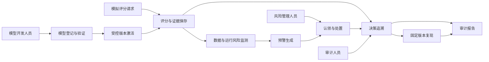
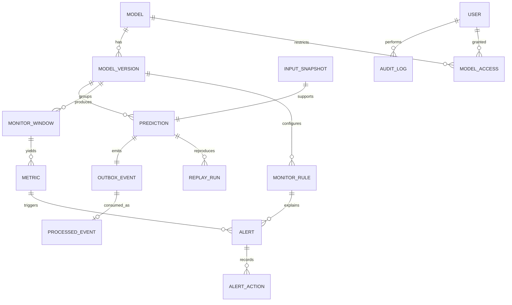
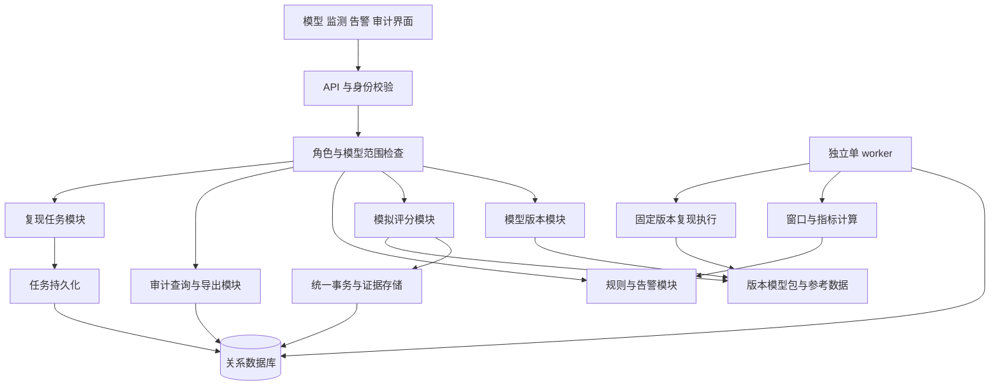
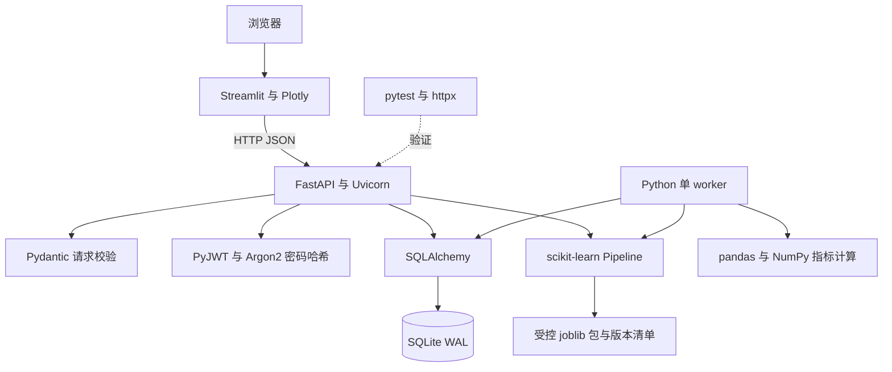
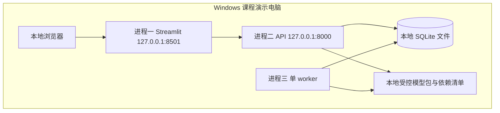

# 五类架构设计

以下 Mermaid 图是可编辑设计稿。可在支持 Mermaid 的 Markdown 查看器预览；正式提交时使用 diagrams.net 整理为与 Word 模板一致的清晰图，保留源文件。图中均为基础版方案，没有暗示系统已经实现或部署。

## 1 业务架构

主笔 A，B 检查审计闭环。业务架构说明角色和业务环节，不把它画成技术组件清单。

核心闭环：监测结果通过告警进入人工处置；审计沿评分证据和处置记录追踪，不用新的推理覆盖旧记录。

## 2 数据架构

主笔 B，A 检查指标维度和模型包关系。这里只画核心实体；用户权限、规则修订与处置明细按数据字典补充。

模型包文件与参考数据放在受控版本目录，SQLite 存索引、摘要和业务记录。模型包缺失时仍能查看历史证据，但复现明确失败。ER 图中的 outbox 关系限定为每次评分的主完成事件；其他任务事件不复用此一对一约束。

## 3 逻辑架构

主笔 A，B 检查事务与权限位置。模块是职责边界，不意味着每个模块独立部署。

权限模块在后端执行，界面只负责交互。监测消费与复现任务按任务类型分派，基础版顺序执行；复现采用轻量模型，若阻塞监测超过目标需限制任务量或拆 worker，再调整设计与验证。

## 4 技术架构

主笔 B，A 检查算法与依赖是否匹配。

设计决策：使用逻辑回归而非复杂深度模型，便于解释与复现；使用 Streamlit 减少双人原型的前端成本；使用 SQLite 降低安装负担，但保留数据库访问边界以便后续迁移。模型文件只来自受控训练脚本。

## 5 系统部署架构

主笔 B，A 按启动顺序验证。基础版一台电脑三个应用进程，一个本地数据目录。

部署限制：worker 停止可补算，但电脑、数据库或磁盘故障会影响整个系统；该方案不具备多机高可用。WAL 保留单写者限制，因此采用短事务、单 worker 和有界锁重试。运行时备份使用 SQLite 备份 API 或停写后的完整一致备份，不能随意只复制正在写入的主数据库文件。

可选演进：先把 SQLite 替换为 PostgreSQL并验证迁移，再按需求引入多个 worker 和独立模型服务；只有确有吞吐与可靠性需求时再选消息中间件。扩展图应另绘，不混入基础版。

## 6 数据流图绘制指导

五类架构图不能代替模板要求的数据流图。正式报告另绘：

- 上下文图：外部实体为模型开发人员、模拟评分调用方、风险人员、审计人员和管理员；中央处理为本平台。
- 一级图：P1 模型登记与验证、P2 评分与留痕、P3 指标与预警、P4 告警处置、P5 审计与复现、P6 身份与授权。
- 数据存储：D1 模型元数据与模型包引用、D2 评分及输入证据、D3 监测与规则、D4 告警处置、D5 审计与复现、D6 用户权限。
- 主要数据流：版本元数据、评分输入、评分结果、监测事件、窗口指标、告警及处置、审计请求与证据、复现请求与结果。

检查每条箭头表达的是数据，不是“下一步”的控制指令；上下文与一级图的外部输入输出应守恒，数据存储不能绕过处理直接连接外部用户。
