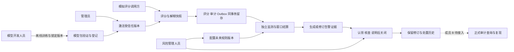
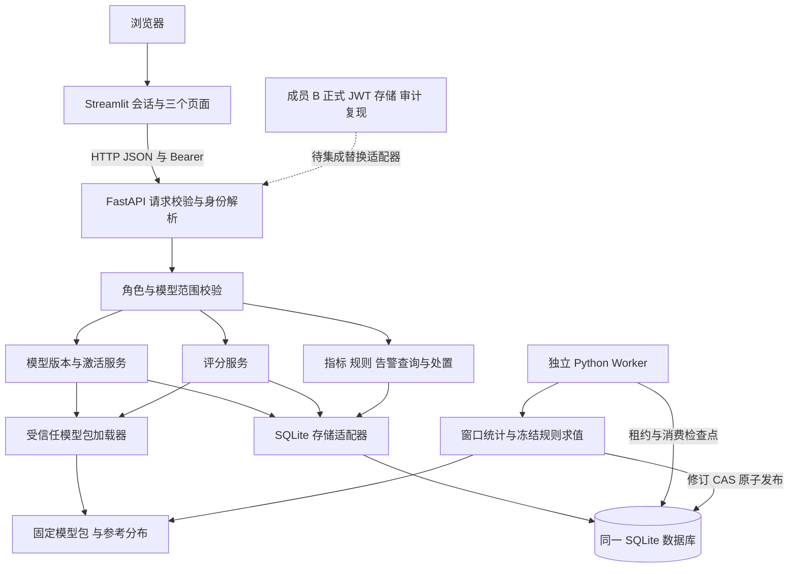
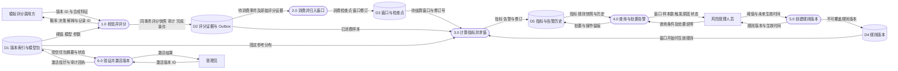

# A5 业务、逻辑架构与一级数据流图

本页按 A1—A5 已实现内容绘制。虚线表示 B 待完成的集成；实体用户角色仍由演示认证适配器提供。源文件位于 `docs/diagrams/`，可在支持 Mermaid 的编辑器和 GitHub 预览。

## 业务架构

## 逻辑架构

## 一级数据流图

业务图强调登记、激活、评分、监测、处置和留痕的闭环。模型登记来自受控模型包和 API 启动校验，没有实现任意模型上传业务。

逻辑图中 Streamlit 只访问 API；后端负责权限和事务。监测 Worker 是独立进程，评分后即使它暂时停止仍能保留事件。它在统计前后通过持久检查点、窗口修订和 CAS 防止重复发布。B 的 JWT、审计查询和复现不计入当前实现。

一级数据流图用方框表示外部实体、圆角节点表示加工、圆柱表示逻辑存储。所有边都是业务数据或结果，不是控制调用。D2、D3、D4、D5 以及 D1 的关系数据部分位于同一个 SQLite 文件，D1 的模型包部分在 artifacts 目录；画成多个存储表示职责，没有额外数据库。D2 中评分、审计与主完成事件由同一事务写入；D5 中指标、告警和修订原子发布。当前 DFD 聚焦 A 负责的已登记模型版本工作流，离线训练与 B 的审计查询、复现编排另行展开。
