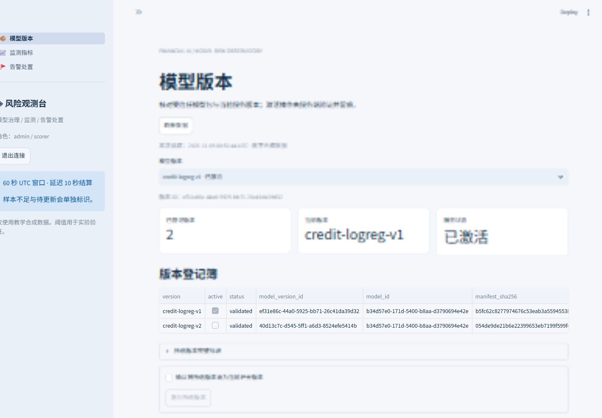
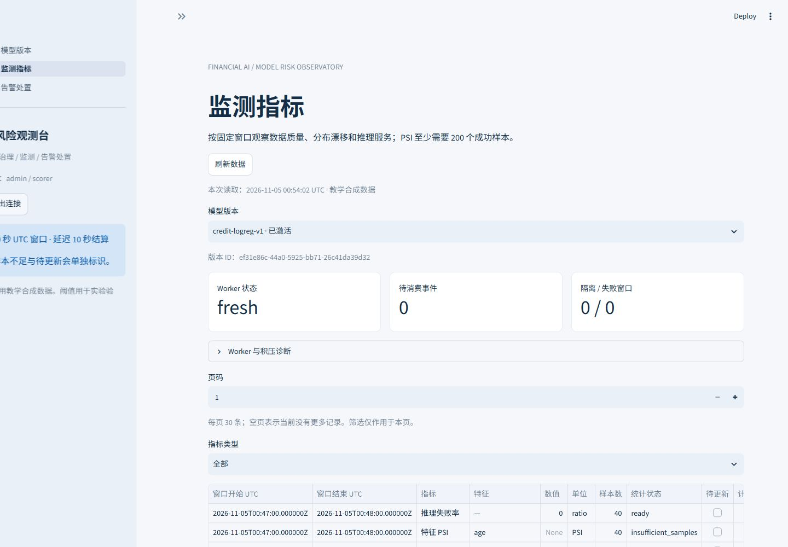
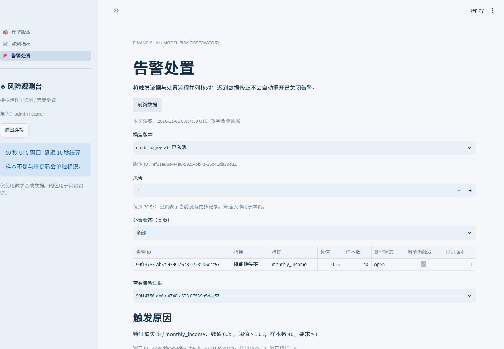
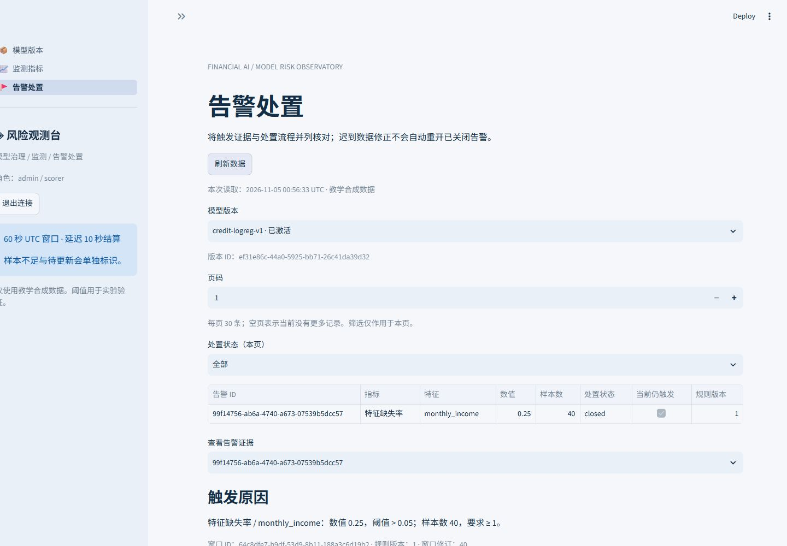

# A5 实际页面与验证记录

验证环境：Windows AMD64、Python 3.12.14，完整依赖见 `requirements-a5.lock.txt`。本地隔离 FastAPI 18005、Streamlit 18506，使用同一套 40 条合成评分与真实 Worker 结果。复现脚本默认 UI 端口为 18505；本次修订期间使用独立 18506 入口复验。

## 模型版本

管理员可查看两版的激活状态、UUID 与清单摘要。已激活版本的激活按钮禁用，未激活版本需要确认；只读 scorer 不显示激活表单。

## 监测指标

真实 API 返回固定 UTC 窗口、样本数、数值单位和统计状态。40 个成功样本小于 PSI 最少 200 的要求，因此 PSI 保留空值并显示 insufficient_samples。Worker 心跳和队列积压可单独查看。新增规则表单及版本列表在页面下方。

## 告警处置

收入缺失 10/40=0.25，超过默认阈值 0.05，规则版本为 1。详情列出实际样本数、规则快照、窗口标识、修订与处置状态。测试覆盖先认领再关闭、关闭必填说明及关闭后条件修正的展示。

浏览器实际完成认领、填写关闭说明、关闭和刷新；随后通过 API 只读核对状态为 closed，并保留 acknowledged、closed 两条动作。见 [浏览器流程记录](../evidence/A5-browser-smoke.json)。

## 已执行与限制

A1—A5 共 108 项测试通过，其中 A5 18 项；[机器可读结果](../evidence/A5-validation-summary.json)。真实 HTTP 评分与 Worker 结算结果见 [演示种子结果](../evidence/A5-preview-seed.json)。页面检查包含桌面布局与默认窄视口的登录和导航。

截图来自实际运行界面，没有将令牌、真实金融数据或本地数据库提交。演示采用明确标注的测试结算时钟推进 120 秒，不能据此声称监测实时延迟达到目标。B 的正式 JWT、审计与复现平台、人工作业验收和性能压测仍待完成。
