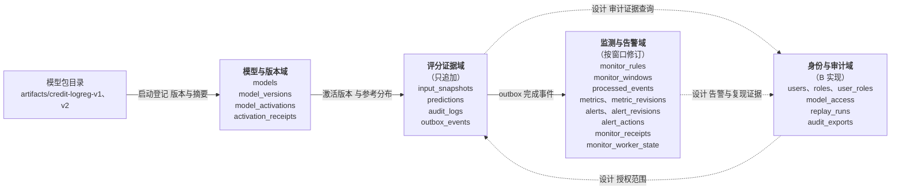
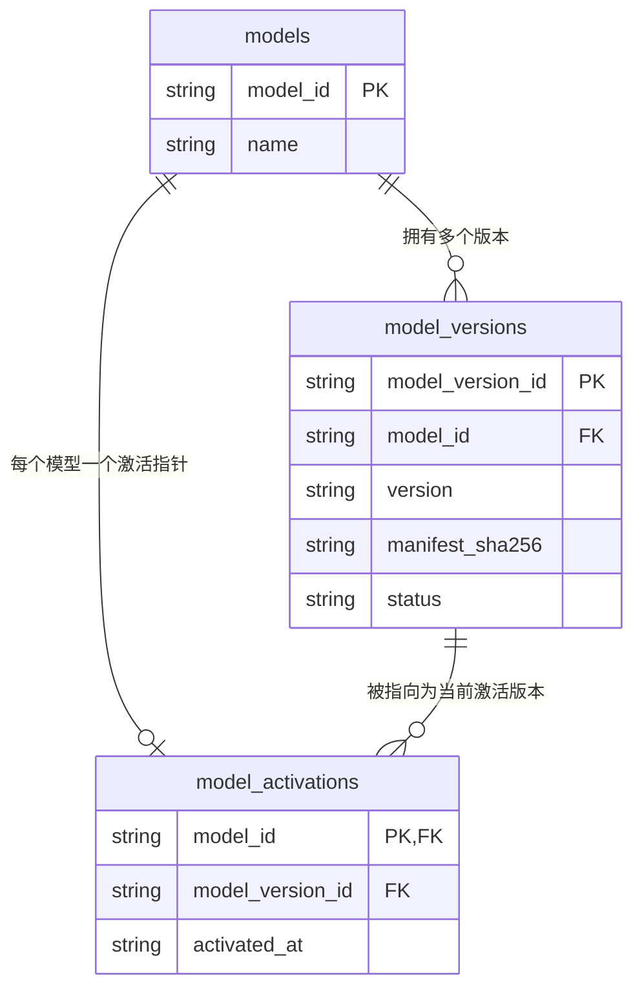
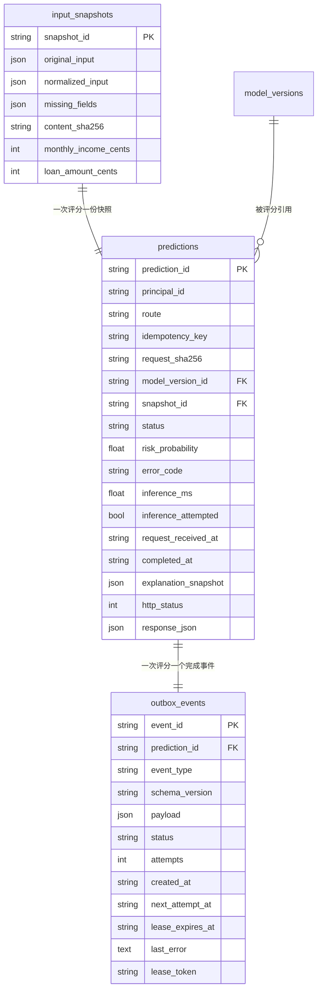
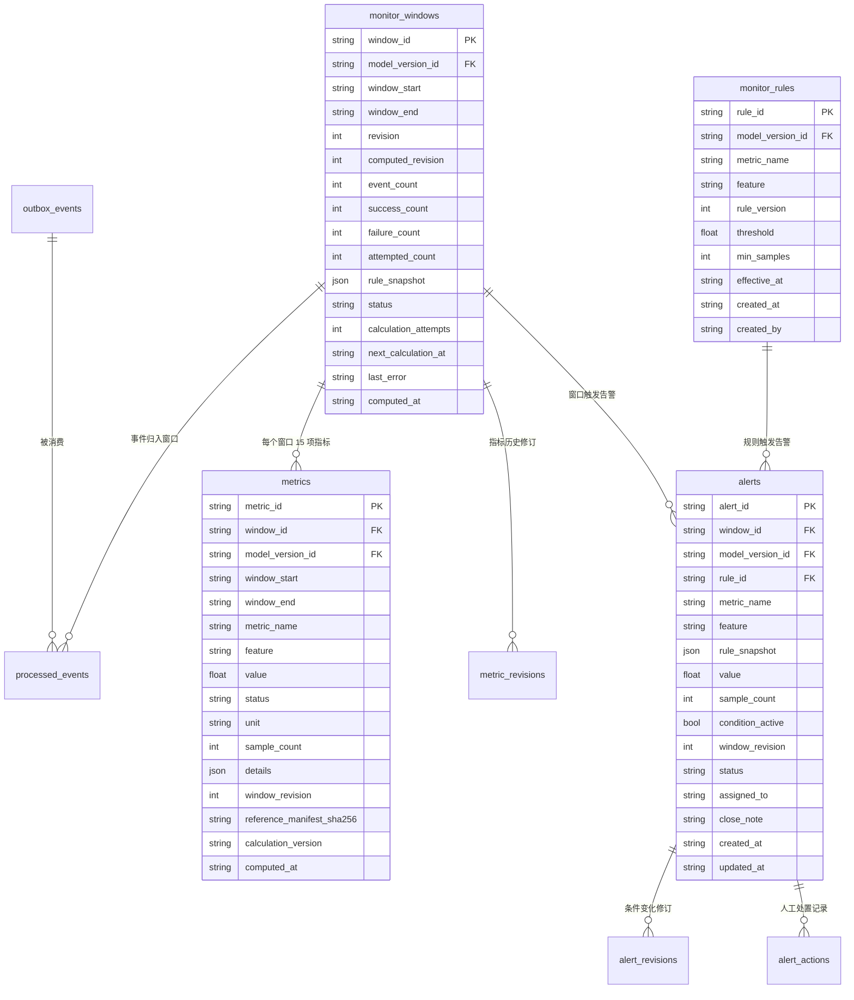
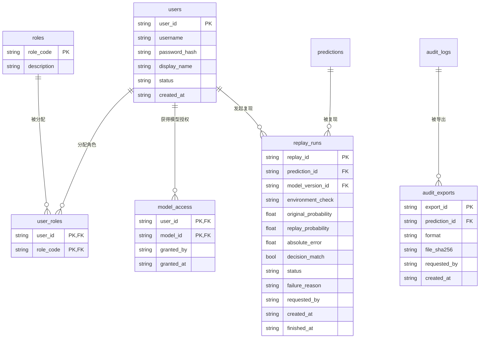

# B1 数据架构与数据字典

本文档由成员 B 编写，对应《软件设计与体系结构》课程报告中的「数据架构」与「数据字典」两项交付。

内容分三层：数据域划分描述数据归谁写、谁读、活多久；实体关系图描述结构；数据字典落到字段。

**范围声明**：第 2、3、4.1—4.3、5、6、7 节描述的是 A1—A5 已实现并随 108 项自动化测试交付的真实结构，字段与约束直接取自 `app/storage/sqlite_store.py` 与 `app/modules/monitoring/schema.py`。第 3.4 节的身份、审计导出与复现实体由成员 B 实现（`app/db/schema.py`），表结构与本节一致。

## 1 数据架构总览

### 1.1 划分依据

系统按**写入者**划分数据域，而不是按页面或按技术分。理由是：本平台的核心质量属性是可追溯性，而可追溯性由"谁在什么事务里写了什么"决定。同一域内的表由同一个模块在同一事务边界内写入，跨域只允许通过外键引用或通过 outbox 事件异步传递。

四个域：

| 数据域 | 写入者 | 读 | 生命周期 |
|---|---|---|---|
| 模型与版本域 | 启动时的受信任登记、管理员的激活命令 | 全部模块 | 版本永久保留，激活指针可切换 |
| 评分证据域 | 评分 API 的单事务 | 评分 API（幂等重放）、监测 Worker、B 的审计查询 | 只追加，不更新、不删除 |
| 监测与告警域 | 独立 Worker 的两段事务 | Worker、三个页面、B 的审计查询 | 指标与告警按窗口保留修订历史 |
| 身份与审计域（B 实现） | 认证适配器、审计导出与复现服务 | 权限层、B 的审计页面 | 用户与授权可变更，审计与复现记录只追加 |

### 1.2 数据架构图

实线为已实现的数据流，虚线为 B 待接入的引用。图中每个域框内列出该域的实体，实体级结构与约束见第 2、3 节。

### 1.3 三条跨域规则

1. **模型域只被引用，不被评分域修改。** 评分记录保存 `model_version_id` 外键，模型包在磁盘按版本目录固定；激活指针切换不触碰历史评分。
2. **评分域到监测域只走 outbox。** Worker 不读 `predictions` 表做增量扫描，只认领 `outbox_events`。因此 Worker 停机不影响评分落库，恢复后按事件补算。
3. **监测域不回收评分域的事实。** 窗口只保存计数与事件引用，不复制原始输入；需要原始输入时按 `prediction_id` 回查快照。

## 2 实体关系图

按域拆成三张，避免单图节点过多难以阅读。主键统一为 UUID 字符串，外键关系与数据库一致。

### 2.1 模型与版本域

`model_activations` 以 `model_id` 为唯一主键，因此每个模型至多一个激活版本；切换激活是更新这一行，不是新增一行历史。激活历史由 `audit_logs` 与 `activation_receipts` 保存。

### 2.2 评分证据域

`predictions` 与 `outbox_events` 是一对一（`prediction_id` 上唯一约束）。评分事务必须同时写入四张表：`input_snapshots`、`predictions`、`audit_logs`、`outbox_events`；任一失败整体回滚。

### 2.3 监测与告警域

### 2.4 身份与审计域（B 实现）

## 3 数据字典

格式说明：类型列为数据库存储类型；「写者」列为写入该字段的模块；「去向」列为主要读取方。时间字段一律为带 `Z` 的 UTC ISO 8601 字符串。

### 3.1 模型与版本域

#### models

| 字段 | 类型 | 可空 | 含义 | 取值 / 单位 | 写者 |
|---|---|---|---|---|---|
| model_id | TEXT | 否 | 模型标识 | UUID 字符串 | 启动登记 |
| name | TEXT | 否 | 模型名称 | 如「模拟信贷评分模型」 | 启动登记 |

#### model_versions

| 字段 | 类型 | 可空 | 含义 | 取值 / 单位 | 写者 |
|---|---|---|---|---|---|
| model_version_id | TEXT | 否 | 版本标识 | UUID 字符串 | 启动登记 |
| model_id | TEXT | 否 | 所属模型 | 引用 models.model_id | 启动登记 |
| version | TEXT | 否 | 版本号 | 如 credit-logreg-v1，与 model_id 联合唯一 | 启动登记 |
| manifest_sha256 | TEXT | 否 | 模型包清单摘要 | 64 位十六进制 | 启动登记 |
| status | TEXT | 否 | 版本状态 | validated（已实现路径中固定为该值，激活态由 model_activations 表达） | 启动登记 |

约束：`UNIQUE(model_id, version)`。历史版本不覆盖；包完整性由 `manifest_sha256` 与磁盘摘要比对发现。

#### model_activations

| 字段 | 类型 | 可空 | 含义 | 取值 / 单位 | 写者 |
|---|---|---|---|---|---|
| model_id | TEXT | 否 | 模型标识，主键 | 引用 models.model_id | 管理员激活命令 |
| model_version_id | TEXT | 否 | 当前激活版本 | 引用 model_versions.model_version_id | 管理员激活命令 |
| activated_at | TEXT | 否 | 激活时间 | UTC ISO 8601 | 管理员激活命令 |

不变量：`model_activations.model_version_id` 必须属于同一 `model_id` 的版本。切换激活只更新本行，历史评分仍指向原版本。

#### activation_receipts

| 字段 | 类型 | 可空 | 含义 | 取值 / 单位 | 写者 |
|---|---|---|---|---|---|
| principal_id | TEXT | 否 | 调用主体，联合主键 | 令牌解析出的主体标识 | 激活命令 |
| route | TEXT | 否 | 幂等作用域，联合主键 | 固定 /api/v1/model-versions/activate | 激活命令 |
| idempotency_key | TEXT | 否 | 幂等键，联合主键 | 1—128 位字母、数字、点、下划线、冒号、连字符 | 激活命令 |
| request_sha256 | TEXT | 否 | 请求体摘要 | 64 位十六进制 | 激活命令 |
| response_json | TEXT(JSON) | 否 | 原样回执 | 完整响应体 | 幂等重放 |
| http_status | INTEGER | 否 | 原响应状态码 | 200 / 409 | 幂等重放 |

### 3.2 评分与证据域

#### input_snapshots

| 字段 | 类型 | 可空 | 含义 | 取值 / 单位 | 写者 | 去向 |
|---|---|---|---|---|---|---|
| snapshot_id | TEXT | 否 | 快照标识 | UUID | 评分事务 | 评分、审计 |
| original_input | TEXT(JSON) | 否 | 原始请求输入 | 六个特征与可选 customer_ref，未填补 | 评分事务 | 审计复现 |
| normalized_input | TEXT(JSON) | 否 | 规范化后输入 | 金额保留两位小数字符串，缺失为 null | 评分事务 | 监测、复现 |
| missing_fields | TEXT(JSON) | 否 | 缺失字段名列表 | 六个特征名的子集，可为空数组 | 评分事务 | 缺失率统计 |
| content_sha256 | TEXT | 否 | 输入内容摘要 | 64 位十六进制 | 评分事务 | 一致性校验 |
| monthly_income_cents | INTEGER | 是 | 月收入，分 | 0—100000000 | 评分事务 | 查询索引 |
| loan_amount_cents | INTEGER | 是 | 贷款金额，分 | 1—1000000000 | 评分事务 | 查询索引 |

设计取舍：原始输入与规范化输入分列保存。只在规范化后输入上做模型推理，但缺失率统计必须基于原始输入，否则填补后的值会掩盖缺失。金额以整数分冗余保存，避免用二进制浮点做跨记录汇总。

#### predictions

| 字段 | 类型 | 可空 | 含义 | 取值 / 单位 | 写者 |
|---|---|---|---|---|---|
| prediction_id | TEXT | 否 | 评分记录标识 | UUID | 评分事务 |
| principal_id | TEXT | 否 | 调用主体 | 令牌解析结果，不接受客户端传参 | 评分事务 |
| route | TEXT | 否 | 幂等作用域 | 固定 /api/v1/predictions | 评分事务 |
| idempotency_key | TEXT | 否 | 幂等键 | 1—128 位 | 评分事务 |
| request_sha256 | TEXT | 否 | 请求体摘要 | 忽略对象键顺序后的规范化 JSON 摘要 | 评分事务 |
| model_version_id | TEXT | 否 | 使用的模型版本 | 引用 model_versions | 评分事务 |
| snapshot_id | TEXT | 否 | 输入快照 | 引用 input_snapshots | 评分事务 |
| status | TEXT | 否 | 终态 | success / failed | 评分事务 |
| risk_probability | REAL | 是 | 风险概率 | 0—1，failed 时必须为空 | 评分事务 |
| error_code | TEXT | 是 | 失败分类 | 如 INFERENCE_TIMEOUT、INFERENCE_ERROR，success 时必须为空 | 评分事务 |
| inference_ms | REAL | 是 | 推理耗时 | 毫秒，仅覆盖 predict_proba | 评分事务 |
| inference_attempted | INTEGER | 否 | 是否进入推理 | 1 / 0；加载前失败记 0 | 评分事务 |
| request_received_at | TEXT | 否 | 受理时间 | UTC ISO 8601，决定所属窗口 | 评分事务 |
| completed_at | TEXT | 否 | 完成时间 | UTC ISO 8601 | 评分事务 |
| explanation_snapshot | TEXT(JSON) | 是 | 解释快照 | 全部特征贡献 + 绝对值前三项 | 评分事务 |
| http_status | INTEGER | 否 | 响应状态码 | 201 / 422 / 500 / 503 | 评分事务 |
| response_json | TEXT(JSON) | 否 | 完整响应体 | 用于幂等重放，逐字节一致 | 评分事务 |

两条 CHECK 约束把状态与可用字段绑定：

- `status='success'` 时 `risk_probability` 非空且在 0—1、`error_code` 为空；`status='failed'` 时相反。数据库层杜绝"有概率又标失败"的脏记录。
- `inference_attempted=1` 时 `inference_ms` 非空且非负；`inference_attempted=0` 时 `inference_ms` 为空。失败率的分子只统计真正尝试过推理的记录，加载前失败不计入分母。

唯一约束：`UNIQUE(principal_id, route, idempotency_key)`。同一主体在同一接口上重复提交同一键，只能落到同一条记录。

#### audit_logs

| 字段 | 类型 | 可空 | 含义 | 取值 / 单位 | 写者 |
|---|---|---|---|---|---|
| audit_id | TEXT | 否 | 审计记录标识 | UUID | 各业务事务 |
| principal_id | TEXT | 否 | 操作者 | 主体标识 | 各业务事务 |
| action | TEXT | 否 | 动作 | 如 prediction.created、model.activated、alert.closed | 各业务事务 |
| resource_id | TEXT | 否 | 被操作资源标识 | 评分/告警/版本标识 | 各业务事务 |
| created_at | TEXT | 否 | 发生时间 | UTC ISO 8601 | 各业务事务 |
| details | TEXT(JSON) | 否 | 变更摘要 | 动作相关字段，禁止写入密码与令牌 | 各业务事务 |

约束：只追加，不提供更新与删除方法。基础版靠应用层权限保证，不宣称能抵御数据库管理员篡改。

#### outbox_events

| 字段 | 类型 | 可空 | 含义 | 取值 / 单位 | 写者 | 读者 |
|---|---|---|---|---|---|---|
| event_id | TEXT | 否 | 事件标识 | UUID | 评分事务 | Worker |
| prediction_id | TEXT | 否 | 关联评分，唯一 | 引用 predictions | 评分事务 | Worker |
| event_type | TEXT | 否 | 事件类型 | 固定 prediction.completed | 评分事务 | Worker |
| schema_version | TEXT | 否 | 事件模式版本 | 如 1.0 | 评分事务 | Worker |
| payload | TEXT(JSON) | 否 | 事件负载 | 评分摘要、特征、缺失信息、耗时 | 评分事务 | Worker |
| status | TEXT | 否 | 消费状态 | pending / processing / done / dead_letter | 评分事务、Worker | 页面 |
| attempts | INTEGER | 否 | 已尝试次数 | 0—5，达到 5 进入 dead_letter | Worker | 页面 |
| created_at | TEXT | 否 | 创建时间 | UTC ISO 8601 | 评分事务 | Worker 排序 |
| next_attempt_at | TEXT | 是 | 下次可领取时间 | 退避 1/2/4/8 秒 | Worker | Worker |
| lease_expires_at | TEXT | 是 | 租约到期时间 | 领取后 30 秒 | Worker | Worker |
| last_error | TEXT | 是 | 最近错误 | 失败原因 | Worker | 人工重试 |
| lease_token | TEXT | 是 | 租约令牌 | 随机 UUID | Worker | 租约校验 |

`lease_token` 是 A4 在 A3 基础上追加的可空列，通过 `ALTER TABLE` 增量迁移兼容旧库，不清空评分数据。它的作用是防止租约过期后旧消费者继续确认已被他人重新认领的工作。

### 3.3 监测与告警域

#### monitor_rules

| 字段 | 类型 | 可空 | 含义 | 取值 / 单位 | 写者 |
|---|---|---|---|---|---|
| rule_id | TEXT | 否 | 规则标识 | UUID | 规则命令 / 初始化 |
| model_version_id | TEXT | 否 | 适用版本 | 引用 model_versions | 同上 |
| metric_name | TEXT | 否 | 指标名 | missing_rate / feature_psi / prediction_psi / failure_rate / inference_p95 | 同上 |
| feature | TEXT | 否 | 适用特征 | 六个特征之一；整体指标为空字符串 | 同上 |
| rule_version | INTEGER | 否 | 规则版本号 | 同版本、指标、特征内递增 | 同上 |
| threshold | REAL | 否 | 阈值 | 比例类 0—1，其他有限非负 | 同上 |
| min_samples | INTEGER | 否 | 最少样本数 | 1—100000，PSI 类至少 200 | 同上 |
| effective_at | TEXT | 否 | 生效时间 | 未来 UTC 整分钟 | 同上 |
| created_at | TEXT | 否 | 创建时间 | UTC ISO 8601 | 同上 |
| created_by | TEXT | 否 | 创建者 | 主体标识 | 同上 |

约束：`UNIQUE(model_version_id, metric_name, feature, rule_version)`。规则只追加，不更新；新版本用递增的 `rule_version` 表达。

空特征约定：`feature` 为非空列，整体指标（预测 PSI、失败率、耗时 P95）统一写空字符串而不是 NULL。这在 SQLite 下还有一个附带好处：唯一约束中的 NULL 互不相等，若用 NULL，同一整体指标可以插入多条重复规则；空字符串参与比较，约束才真正生效。

#### monitor_windows

| 字段 | 类型 | 可空 | 含义 | 取值 / 单位 | 写者 |
|---|---|---|---|---|---|
| window_id | TEXT | 否 | 窗口标识 | UUID | Worker |
| model_version_id | TEXT | 否 | 所属版本 | 引用 model_versions | Worker |
| window_start | TEXT | 否 | 窗口开始 | UTC 整 60 秒边界，左闭 | Worker |
| window_end | TEXT | 否 | 窗口结束 | UTC，右开 | Worker |
| revision | INTEGER | 否 | 最新窗口修订号 | 迟到事件到达时递增 | Worker |
| computed_revision | INTEGER | 否 | 已计算到第几修订 | 小于 revision 表示脏窗口 | Worker |
| event_count | INTEGER | 否 | 窗口内事件总数 | ≥0 | Worker |
| success_count | INTEGER | 否 | 成功评分数 | ≥0 | Worker |
| failure_count | INTEGER | 否 | 失败评分数 | ≥0 | Worker |
| attempted_count | INTEGER | 否 | 尝试推理数 | ≥0，失败率分母 | Worker |
| rule_snapshot | TEXT(JSON) | 否 | 窗口开始时刻冻结的规则 | 规则版本与阈值全量副本 | Worker |
| status | TEXT | 否 | 计算状态 | pending / ready / insufficient_samples / no_data / calculation_failed | Worker |
| calculation_attempts | INTEGER | 否 | 计算尝试次数 | ≥0 | Worker |
| next_calculation_at | TEXT | 是 | 下次计算时间 | UTC ISO 8601 | Worker |
| last_error | TEXT | 是 | 最近计算错误 | 失败原因 | Worker |
| computed_at | TEXT | 是 | 最近计算完成时间 | UTC ISO 8601 | Worker |

约束：`UNIQUE(model_version_id, window_start)`。窗口按版本隔离，不同模型版本的同一时间窗互不影响。

#### processed_events

| 字段 | 类型 | 可空 | 含义 | 取值 / 单位 | 写者 |
|---|---|---|---|---|---|
| consumer | TEXT | 否 | 消费者名，联合主键 | 固定 monitoring-v1 | Worker |
| event_id | TEXT | 否 | 事件标识，联合主键 | 引用 outbox_events | Worker |
| window_id | TEXT | 否 | 归入窗口 | 引用 monitor_windows | Worker |
| processed_at | TEXT | 否 | 消费时间 | UTC ISO 8601 | Worker |

组合主键即去重机制：同一事件对同一消费者只能有一条消费标记。重复事件在写入时被主键冲突拦截，不会重复累计计数。

#### metrics

| 字段 | 类型 | 可空 | 含义 | 取值 / 单位 | 写者 |
|---|---|---|---|---|---|
| metric_id | TEXT | 否 | 指标标识 | UUID | Worker |
| window_id | TEXT | 否 | 所属窗口 | 引用 monitor_windows | Worker |
| model_version_id | TEXT | 否 | 所属版本 | 引用 model_versions | Worker |
| window_start | TEXT | 否 | 窗口开始（冗余） | UTC ISO 8601 | Worker |
| window_end | TEXT | 否 | 窗口结束（冗余） | UTC ISO 8601 | Worker |
| metric_name | TEXT | 否 | 指标名 | 同 monitor_rules.metric_name | Worker |
| feature | TEXT | 否 | 特征名 | 同 monitor_rules.feature | Worker |
| value | REAL | 是 | 指标值 | 比例 0—1、PSI 指数、毫秒；不可计算时为空 | Worker |
| status | TEXT | 否 | 计算状态 | ready / insufficient_samples / no_data | Worker |
| unit | TEXT | 否 | 单位 | ratio / PSI / ms（PSI 类指标的单位记为大写 PSI） | Worker |
| sample_count | INTEGER | 否 | 参与计算样本数 | ≥0 | Worker |
| details | TEXT(JSON) | 否 | 计算明细 | 分箱计数、参考分布摘要等 | Worker |
| window_revision | INTEGER | 否 | 对应窗口修订号 | 与 monitor_windows.revision 对应 | Worker |
| reference_manifest_sha256 | TEXT | 否 | 参考分布摘要 | 64 位十六进制 | Worker |
| calculation_version | TEXT | 否 | 计算口径版本 | 如 psi-v1 | Worker |
| computed_at | TEXT | 否 | 计算时间 | UTC ISO 8601 | Worker |

约束：`UNIQUE(window_id, metric_name, feature)`。每窗口固定 15 行：六项缺失率 + 六项特征 PSI + 预测 PSI + 失败率 + P95。不可计算时写 `value=NULL` 加明确 status，不写伪造的 0。

#### metric_revisions

| 字段 | 类型 | 可空 | 含义 | 取值 / 单位 | 写者 |
|---|---|---|---|---|---|
| window_id | TEXT | 否 | 窗口，联合主键 | 引用 monitor_windows | Worker |
| window_revision | INTEGER | 否 | 修订号，联合主键 | ≥1 | Worker |
| metric_name | TEXT | 否 | 指标名，联合主键 | 同 metrics | Worker |
| feature | TEXT | 否 | 特征名，联合主键 | 同 metrics | Worker |
| record | TEXT(JSON) | 否 | 该修订的完整指标快照 | 含 value、status、sample_count、details | Worker |

作用：`metrics` 只保留最新修订，`metric_revisions` 保留每一次修订。迟到事件触发重算时追加新修订而不覆盖历史，因此"当时看到的指标"可回查。

#### alerts

| 字段 | 类型 | 可空 | 含义 | 取值 / 单位 | 写者 |
|---|---|---|---|---|---|
| alert_id | TEXT | 否 | 告警标识 | UUID | Worker |
| window_id | TEXT | 否 | 触发窗口 | 引用 monitor_windows | Worker |
| model_version_id | TEXT | 否 | 所属版本 | 引用 model_versions | Worker |
| rule_id | TEXT | 否 | 触发规则 | 引用 monitor_rules | Worker |
| metric_name | TEXT | 否 | 指标名 | 同 monitor_rules | Worker |
| feature | TEXT | 否 | 特征名 | 同 monitor_rules | Worker |
| rule_snapshot | TEXT(JSON) | 否 | 规则快照 | 触发时的规则全量副本 | Worker |
| value | REAL | 是 | 触发数值 | 与阈值同单位 | Worker |
| sample_count | INTEGER | 否 | 样本数 | ≥0 | Worker |
| condition_active | INTEGER | 否 | 触发条件当前是否仍成立 | 1 / 0；迟到数据可能改变 | Worker |
| window_revision | INTEGER | 否 | 触发时窗口修订号 | ≥1 | Worker |
| status | TEXT | 否 | 处置状态 | open / acknowledged / closed | 人工命令 |
| assigned_to | TEXT | 是 | 认领人 | 主体标识 | 人工命令 |
| close_note | TEXT | 是 | 关闭说明 | 非空才允许关闭 | 人工命令 |
| created_at | TEXT | 否 | 创建时间 | UTC ISO 8601 | Worker |
| updated_at | TEXT | 否 | 最近更新时间 | UTC ISO 8601 | Worker / 人工命令 |

约束：`UNIQUE(window_id, rule_id)`，同一窗口同一规则只产生一条逻辑告警。特别注意 `condition_active` 与 `status` 是两个独立维度：前者表达"数据上条件是否还成立"，后者表达"人处理到哪一步"，迟到数据只改前者，不覆盖人工处置状态。

#### alert_revisions

| 字段 | 类型 | 可空 | 含义 | 取值 / 单位 | 写者 |
|---|---|---|---|---|---|
| alert_id | TEXT | 否 | 告警，联合主键 | 引用 alerts | Worker |
| window_revision | INTEGER | 否 | 窗口修订号，联合主键 | ≥1 | Worker |
| record | TEXT(JSON) | 否 | 该修订的告警证据快照 | 含 value、sample_count、condition_active | Worker |

#### alert_actions

| 字段 | 类型 | 可空 | 含义 | 取值 / 单位 | 写者 |
|---|---|---|---|---|---|
| action_id | TEXT | 否 | 动作标识 | UUID | 人工命令 |
| alert_id | TEXT | 否 | 所属告警 | 引用 alerts | 人工命令 |
| principal_id | TEXT | 否 | 操作者 | 主体标识 | 人工命令 |
| from_status | TEXT | 否 | 变更前状态 | open / acknowledged | 人工命令 |
| to_status | TEXT | 否 | 变更后状态 | acknowledged / closed | 人工命令 |
| note | TEXT | 否 | 说明 | 关闭时必填 | 人工命令 |
| created_at | TEXT | 否 | 动作时间 | UTC ISO 8601 | 人工命令 |

只追加，不更新。非法状态流转在服务层拦截并返回 409，不产生动作行。

#### monitor_receipts

| 字段 | 类型 | 可空 | 含义 | 取值 / 单位 |
|---|---|---|---|---|
| principal_id | TEXT | 否 | 调用主体，联合主键 | 主体标识 |
| route | TEXT | 否 | 幂等作用域，联合主键 | 如 /api/v1/monitor-rules |
| idempotency_key | TEXT | 否 | 幂等键，联合主键 | 1—128 位 |
| request_sha256 | TEXT | 否 | 请求摘要 | 64 位十六进制 |
| response_json | TEXT(JSON) | 否 | 原样回执 | 完整响应体 |

#### monitor_worker_state

| 字段 | 类型 | 可空 | 含义 | 取值 / 单位 | 写者 |
|---|---|---|---|---|---|
| consumer | TEXT | 否 | 消费者名，主键 | 固定 monitoring-v1 | Worker |
| worker_id | TEXT | 否 | 进程标识 | 主机与进程标识 | Worker |
| last_seen_at | TEXT | 否 | 最近心跳 | UTC ISO 8601；15 秒内视为 fresh | Worker |
| last_result | TEXT(JSON) | 否 | 最近一轮结果 | 处理数、计算数、错误 | Worker |

### 3.4 身份、审计与复现域（B 实现）

以下实体已由成员 B 在 `app/db/schema.py` 实现，字段与本表一致。除 `audit_exports.prediction_id` 外，其余字段的写入时机见第 5、6 节。

#### users

| 字段 | 类型 | 可空 | 含义 | 取值 / 单位 |
|---|---|---|---|---|
| user_id | TEXT | 否 | 用户标识 | UUID |
| username | TEXT | 否 | 登录名，唯一 | ≤64 字符 |
| password_hash | TEXT | 否 | Argon2id 哈希 | 含算法与参数，禁止存明文 |
| display_name | TEXT | 否 | 显示名 | ≤64 字符 |
| status | TEXT | 否 | 账号状态 | active / disabled / locked |
| created_at | TEXT | 否 | 创建时间 | UTC ISO 8601 |

#### roles

| 字段 | 类型 | 可空 | 含义 | 取值 / 单位 |
|---|---|---|---|---|
| role_code | TEXT | 否 | 角色代码，主键 | model_developer / risk_manager / auditor / admin |
| description | TEXT | 否 | 角色说明 | — |

四类角色与文档 01 第 2 节一致。角色是固定枚举，不做用户自定义角色，避免原型范围内出现权限组合爆炸。

#### user_roles

| 字段 | 类型 | 可空 | 含义 | 取值 / 单位 |
|---|---|---|---|---|
| user_id | TEXT | 否 | 用户，联合主键 | 引用 users |
| role_code | TEXT | 否 | 角色，联合主键 | 引用 roles |

#### model_access

| 字段 | 类型 | 可空 | 含义 | 取值 / 单位 |
|---|---|---|---|---|
| user_id | TEXT | 否 | 用户，联合主键 | 引用 users |
| model_id | TEXT | 否 | 获授权模型，联合主键 | 引用 models |
| granted_by | TEXT | 否 | 授权人 | 管理员 user_id |
| granted_at | TEXT | 否 | 授权时间 | UTC ISO 8601 |

授权粒度到 `model_id` 而不是 `model_version_id`：授权一次即覆盖该模型后续全部版本，避免每发一个版本都要重授权。

#### replay_runs

| 字段 | 类型 | 可空 | 含义 | 取值 / 单位 |
|---|---|---|---|---|
| replay_id | TEXT | 否 | 复现记录标识 | UUID |
| prediction_id | TEXT | 否 | 被复现评分 | 引用 predictions |
| model_version_id | TEXT | 否 | 复现所用版本 | 引用 model_versions，必须等于原评分版本 |
| environment_check | TEXT | 否 | 环境核验结果 | pass / mismatch / package_missing / digest_mismatch |
| original_probability | REAL | 是 | 原概率 | 0—1，原记录无概率时为空 |
| replay_probability | REAL | 是 | 新计算概率 | 0—1 |
| absolute_error | REAL | 是 | 绝对误差 | 目标 ≤1e-8 |
| decision_match | INTEGER | 是 | 阈值判断是否一致 | 1 / 0 |
| status | TEXT | 否 | 复现状态 | pending / running / passed / mismatch / failed |
| failure_reason | TEXT | 是 | 失败原因 | 不得为空串 |
| requested_by | TEXT | 否 | 发起人 | user_id |
| created_at | TEXT | 否 | 发起时间 | UTC ISO 8601 |
| finished_at | TEXT | 是 | 终态时间 | UTC ISO 8601，running 时为空 |

不变量：`replay_runs.model_version_id` 必须来自原评分记录，禁止取当前激活版本。环境核验失败时不计算概率，`status=failed` 且写明原因，不允许回退到当前模型给出"近似结果"。

任务由单 worker 分派执行：`pending → running → passed / mismatch / failed`。`mismatch` 表示计算完成但结果不一致，`failed` 表示无法完成计算（包缺失、摘要不符、环境不匹配、错误）。两者不可混为一谈。

#### audit_exports

| 字段 | 类型 | 可空 | 含义 | 取值 / 单位 |
|---|---|---|---|---|
| export_id | TEXT | 否 | 导出记录标识 | UUID |
| prediction_id | TEXT | 否 | 被导出的评分 | 引用 predictions |
| format | TEXT | 否 | 文件格式 | json / csv |
| file_sha256 | TEXT | 否 | 文件摘要 | 64 位十六进制，供接收方核对 |
| requested_by | TEXT | 否 | 发起人 | user_id |
| created_at | TEXT | 否 | 导出时间 | UTC ISO 8601 |

按 `docs/04` 冻结的接口，导出粒度为单条评分证据（`GET /audit/records/{prediction_id}/export`），因此这里记录被导出的评分编号而不是筛选条件。若将来增加批量导出，需先修改 `docs/04` 的接口清单，再为本事新增筛选条件快照与行数字段。

导出动作本身写入 `audit_logs`，`audit_exports` 保存可核对的产物元数据。

## 4 跨表不变量

这些是应用层必须维持、数据库无法单独表达的一致性规则。验收时应逐条设计用例。

| 编号 | 不变量 | 保障方式 | 破坏后果 |
|---|---|---|---|
| INV-01 | 评分事务的四张表在同一事务内提交 | 单 SQLAlchemy 事务 | 有评分无事件，监测漏样本 |
| INV-02 | `predictions.model_version_id` 必须是激活版本 | 服务层事务内校验激活指针 | 历史不可复现，审计口径错乱 |
| INV-03 | 事件消费只产生一份逻辑结果 | `processed_events` 联合主键 | 窗口计数重复，指标偏高 |
| INV-04 | `metrics.window_revision` 与 `monitor_windows.computed_revision` 对应 | 修订号 CAS 发布 | 页面把旧指标当新结果展示 |
| INV-05 | 告警规则来自窗口冻结快照，不读当前规则 | `monitor_windows.rule_snapshot` | 改规则后历史告警证据被改写 |
| INV-06 | 复现必须使用原评分版本 | `replay_runs` 外键 + 服务层校验 | 用新模型冒充历史结果 |
| INV-07 | 审计记录与导出记录只追加 | 存储层不提供 update/delete | 证据链可被业务代码改写 |

## 5 数据生命周期

| 数据 | 产生 | 变更 | 保留 | 清除 |
|---|---|---|---|---|
| 模型包 | 离线训练脚本 | 不可变，版本目录固定 | 永久，随仓库 | 不删 |
| 模型版本元数据 | API 启动登记 | 仅激活指针可换 | 永久 | 不删 |
| 输入快照与评分 | 评分请求 | 不可变 | 永久（演示量级） | 不删 |
| 审计日志 | 业务事务 | 不可变 | 永久 | 不删 |
| outbox 事件 | 评分事务 | 状态机推进 | 永久 | 不删 |
| 窗口与指标 | Worker | 修订递增 | 永久 | 不删 |
| 规则 | 规则命令 | 新版本追加 | 永久 | 不删 |
| 告警 | Worker / 人工 | 状态推进 | 永久 | 不删 |
| 用户与授权（B 实现） | 管理员 | 可改 | 账号禁用不删记录 | 不删 |
| 复现记录（B 实现） | 复现任务 | 不可变 | 永久 | 不删 |

设计取舍：原型阶段一律不删数据。演示数据量在万条以内，删除带来的审计断链风险远大于存储收益。真实平台上应补数据保留策略与脱敏归档，这属于扩展范围。

## 6 一致性与并发策略

### 6.1 事务边界

- **评分**：一个事务写 `input_snapshots`、`predictions`、`audit_logs`、`outbox_events`。提交后返回，提交前失败返回 503 并允许同键重试。
- **激活**：一个事务更新 `model_activations`、写 `audit_logs`、写 `activation_receipts`。
- **事件消费**：短事务写 `processed_events`、`monitor_windows` 计数与修订、事件 `done` 状态。
- **指标发布**：第二个事务写 `metrics`、`metric_revisions`、`alerts`、`alert_revisions`、`computed_revision`，以修订号做比较后交换（CAS）。
- **人工处置**：一个事务写 `alerts` 状态、`alert_actions`、`audit_logs`、`monitor_receipts`。

### 6.2 并发控制

SQLite 启用 WAL、`foreign_keys=ON`、`busy_timeout=5000`。写入串行，读取不阻塞。该配置适配"单 API + 单 Worker"的演示拓扑；并发写入规模上升时需迁移 PostgreSQL，迁移点在于存储适配器边界（`PredictionStore` 协议），见文档 04 第 8 节。

事件领取用租约而非行锁：`lease_expires_at` 到期后事件可被重新认领，`lease_token` 防止旧领取者确认新租约。这样 Worker 崩溃后无需人工干预即可恢复，且不会出现两个消费者同时确认同一事件。

### 6.3 幂等的三层实现

1. **接口层**：`Idempotency-Key` 请求头必填，长度 1—128。
2. **记录层**：`predictions`、`activation_receipts`、`monitor_receipts` 各有 `UNIQUE(principal_id, route, idempotency_key)`。
3. **语义层**：同键同内容返回原回执（`response_json` 原样重放）；同键不同内容返回 409。

## 7 存储实现与迁移

| 项 | 当前实现 | 迁移方向 |
|---|---|---|
| 数据库 | SQLite 文件，WAL 模式 | PostgreSQL，通过 `PredictionStore` 协议替换 |
| 访问层 | SQLAlchemy Core（Table 对象，非 ORM） | 保持，ORM 在此规模下无收益 |
| 迁移方式 | `metadata.create_all` + 增量列检查 | Alembic 版本化迁移 |
| 大字段 | JSON 存 TEXT，与应用共享同一连接 | PostgreSQL 用 JSONB 并建 GIN 索引 |
| 时间 | 全部 UTC ISO 8601 字符串 | 迁移为 timestamptz |

`metadata.create_all` 只建缺失表，不改已有表结构，因此追加列必须显式检查并 `ALTER TABLE`——A4 的 `lease_token` 就是这样加进 A3 旧库的。B 接入正式存储时沿用该做法，旧库升级不清空评分数据。

## 8 与需求条目的追溯

| 数据实体 | 对应需求 | 验收证据 |
|---|---|---|
| models / model_versions / model_activations | FR02、FR03 | test_model_package.py、test_scoring_api.py |
| input_snapshots / predictions | FR04 | test_scoring_api.py |
| outbox_events / processed_events | FR05 | test_monitoring_worker.py |
| monitor_windows / metrics / metric_revisions | FR06 | test_monitoring_worker.py |
| monitor_rules | FR07 | test_monitoring_worker.py |
| alerts / alert_revisions / alert_actions | FR08 | Worker 与页面测试 |
| audit_logs | FR03—FR09 | 各事务测试 |
| users / roles / user_roles / model_access | FR10、FR11 | tests/test_auth.py |
| replay_runs / audit_exports | FR15、FR16、FR17 | tests/test_audit_replay.py |

上表用于报告中的需求—设计—验证对应关系。审计与复现页面（FR18、FR19）尚未实现，对应的页面级验证待补充。
