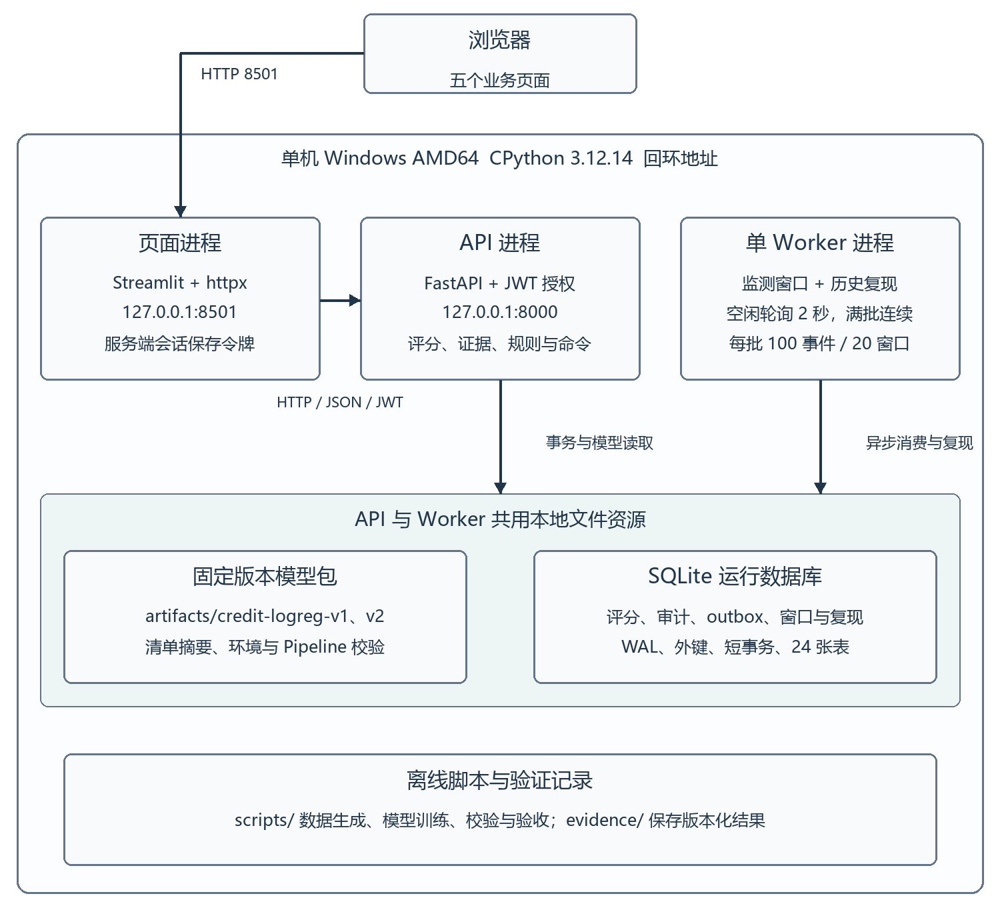

# B5 技术架构与部署架构

本组以 A1—A5 的模型监测链路与 B1—B5 的身份审计链路构建单机原型。本文对应最终整合代码 ab72dd8，合作基线为 26d1e4b，分支为 integration/final-20261119。

## 1 技术架构

系统采用分层结构与适配器边界。Streamlit 页面经 httpx 调用 FastAPI；接口层校验输入、身份、角色及模型范围；应用服务组织评分、激活、规则、告警、审计与复现；领域模块处理特征、固定模型和窗口统计；SQLite 及模型包位于资源层。页面不直接读取数据库或模型文件。

表现层包含模型版本、监测指标、告警处置、审计查询、复现任务五个页面。身份认证采用 Argon2id 密码哈希和短期 HS256 JWT，令牌携带用户标识，角色及模型授权逐请求查库。正式认证与演示 Bearer 入口通过 Authenticator 协议接入，页面按钮由服务端授权兜底。

PredictionService 同步推理并提交评分证据，MonitoringWorker 异步消费 outbox 和结算窗口，ReplayService 读取历史模型及原始输入重新推理。数据字典由 app/db/schema.py 统一定义，共 24 张表；原有数据库使用增量初始化兼容。

## 2 关键设计决策

- TD-01：评分与监测分进程。输入快照、评分、初始审计与 prediction.completed 事件同事务提交；监测故障不阻止数据库可用时的新评分。
- TD-02：模型包固定版本。清单独立登记受信任摘要，历史复现始终使用原版本、原始输入和原依赖环境。
- TD-03：模型加载先校验再解析。清单及各包文件只读取一份字节，SHA-256 校验通过后解析同一份内容；joblib 反序列化缓存以不可变字节为键，逐次文件摘要和环境核验继续执行。
- TD-04：幂等命令保留回执。复现创建以操作者、幂等键匹配 replay.requested 审计，同键同评分返回原任务当前状态，同键异内容返回 409。
- TD-05：监测窗口为 UTC 60 秒左闭右开区间，窗口结束后保留 10 秒宽限；规则按窗口起点冻结，迟到事件产生修订并重算。
- TD-06：规则按窗口开始时间冻结快照，后续修改不改变原窗口规则。
- TD-07：窗口、指标与告警保留修订历史，迟到数据和重新结算可追溯。
- TD-08：页面重绘时重新获取服务端身份，接口逐请求检查角色及模型授权。
- TD-09：复现创建在 BEGIN IMMEDIATE 写事务内检查与插入，不同键对同一评分的活动任务返回 409。回执通过数据库 JSON 条件检索，避免应用层遍历全部历史记录。
- TD-10：Worker 空闲时每 2 秒轮询，单轮最多消费 100 个事件、计算 20 个窗口，满批后连续处理，每个事件事务间让出 20 毫秒。进程内写锁协调 SQLite 连接使用，跨进程仍依赖 SQLite 事务锁。
- TD-11：复现使用单 Worker。重启时将遗留 running 任务恢复为 pending，并追加 replay.recovered 审计；旧进程退出后才允许重启。

## 3 技术选型

运行环境为 Windows AMD64、CPython 3.12.14。接口使用 FastAPI 0.162.0、Pydantic 2.14.2 和 Uvicorn；存储使用 SQLAlchemy 2.0.57 与 SQLite WAL；模型使用 scikit-learn 1.9.1、NumPy 2.5.4、SciPy 1.18.1 和 joblib 1.6.0；页面使用 Streamlit 1.66.1、pandas 3.1.1、Altair 6.3.0，HTTP 客户端为 httpx 0.28.1。完整依赖以 requirements-a5.lock.txt 和模型包 environment.json 为准。

本组未部署外部消息队列、Redis、独立模型服务和前端构建链。持久 outbox 满足当前事务边界，已校验字节缓存降低重复反序列化开销。SQLite 单写者及单 Worker 限制持续并发规模，当前实验未覆盖跨机高可用。

## 4 部署架构

单机运行 API、Worker、页面三个独立进程。API 与 Worker 共享 SQLite 文件及 artifacts/ 模型包，页面通过 HTTP 访问 API。默认 API 为 127.0.0.1:8000，页面为 127.0.0.1:8501。本次实测分别使用 18100、18519 端口；隔离恢复实验使用数据库备份，未终止主服务。

scripts.run_demo 初始化运行库、登记模型及四类实验账号，生成本地认证配置后启动三个进程。DATABASE_URL 与 ARTIFACT_ROOT 定位共享资源，JWT_SECRET 配置正式认证，TOKEN_TTL_MINUTES 默认 30；APP_ADMIN_TOKEN、APP_SCORER_TOKEN 用于原演示入口，API_BASE_URL 用于页面调用。密钥、数据库与本地账号配置保存在忽略的运行目录。

API 不可用时评分与查询中断；Worker 停止时监测和复现延后，但已提交 outbox 保留；页面关闭不影响后端。数据库不可写时返回失败，不能承诺新评分成功。模型摘要或环境不匹配时拒绝加载，不回退到其他版本。

## 5 整合验证

158 项自动化测试全部通过。5 并发 500 次真实 HTTP 评分 P95 为 70.4 ms；三轮 20 并发各 100 次的 P95 为 233.7、258.5、248.6 ms，全部 800 次请求成功。新监测窗口在结束后 10.342 秒结算，事件积压为 0。

Worker 停止期间提交 100 条评分，恢复后消费 100 条且无重复；两版模型各 10 条历史评分复现均 passed、误差为 0。独立进程强制中断恢复、五个页面和角色隔离均通过，证据位于 evidence/acceptance-20261119。
