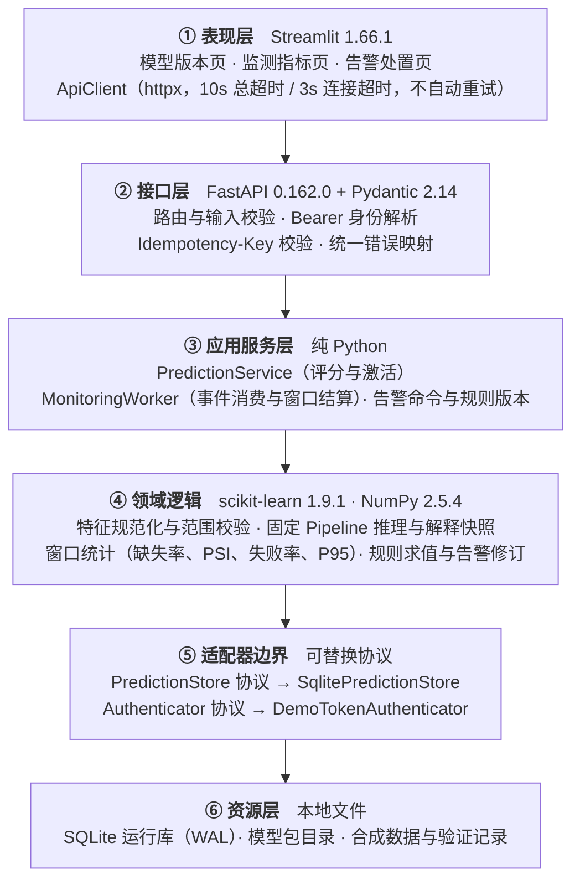
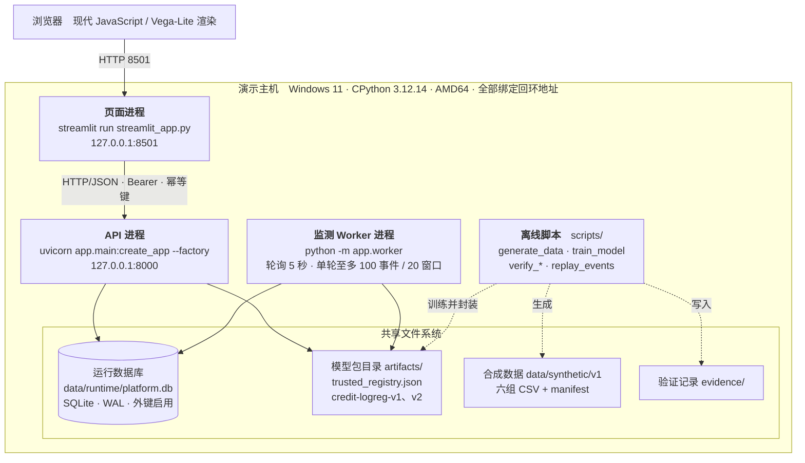

# B5 技术架构与部署架构

本文档由成员 B 编写，对应课程报告中的「技术架构」与「系统部署架构」两项交付。

**范围声明**：技术架构描述 A1—A5 已交付系统的分层、组件与选型，事实取自 `app/`、`ui/`、`requirements-a5.lock.txt` 与 `.env.example`。部署架构描述当前单机演示拓扑。B 计划引入的身份、审计与复现能力在文中以「B 设计」标注，**尚未实现**。

## 1 技术架构

### 1.1 架构风格

系统采用**分层 + 适配器边界**的结构，不是微服务，也不是纯 MVC。三个判断决定了这个形态：

1. **评分请求必须同步返回，监测计算必须异步且可恢复。** 因此把"评分"和"监测"拆成两个进程，中间用持久化 outbox 连接，而不是在请求线程里直接算指标。这是可用性需求（ASR-01）直接推导出的结构，不是技术偏好。
2. **模型必须是固定版本、可复现的。** 因此模型不进数据库、不做热更新，而是以版本目录 + 清单摘要的形式固定在磁盘上，加载前先校验环境与摘要。
3. **原型不能引入额外运维组件。** 因此不引入消息队列、Redis、独立模型服务或前端构建链。所有这些都可以在适配器边界处替换，见 1.7。

### 1.2 技术架构图

### 1.3 分层职责

| 层 | 组成 | 允许依赖 | 禁止事项 |
|---|---|---|---|
| ① 表现层 | `ui/app.py`、`ui/pages/*`、`ui/api_client.py` | 仅通过 HTTP 调用 API | 不直接访问数据库或模型文件；不自行计算指标 |
| ② 接口层 | `app/main.py`、Pydantic 模型、`HTTPBearer` 依赖 | 应用服务层 | 不在路由函数里写业务分支；不返回原始异常栈 |
| ③ 应用服务层 | `PredictionService`、`MonitoringWorker`、告警命令 | 领域逻辑与适配器协议 | 不直接 import SQLAlchemy 表对象（`MonitoringStore` 除外，它是适配器实现） |
| ④ 领域逻辑 | `schema.py`、`predict.py`、`statistics.py`、规则求值 | 仅纯函数与模型包 | 不读写数据库；不依赖 FastAPI 或 Streamlit |
| ⑤ 适配器边界 | `contracts.py` 中的 `Protocol` 与两个实现 | 资源层 | 协议不含实现细节；上层只面向协议编程 |
| ⑥ 资源层 | SQLite 文件、`artifacts/`、`data/`、`evidence/` | — | 由适配器独占访问，避免多处直连 |

**关键约束**：领域逻辑层不 import 数据库或 Web 框架。这一条使窗口统计可以在测试中脱离数据库直接验证（`tests/test_monitoring_worker.py` 即按此组织），也是 B 替换存储实现时不必改统计代码的原因。

### 1.4 技术选型与理由

| 用途 | 选型 | 版本 | 选择理由 | 代价与边界 |
|---|---|---|---|---|
| Web 接口 | FastAPI + Uvicorn | 0.162.0 / 0.54.0 | 原生 Pydantic 校验、自动 OpenAPI、依赖注入便于统一鉴权 | 同步函数在单进程下受 GIL 限制，不适合高并发 |
| 输入契约 | Pydantic | 2.14.2 | `extra="forbid"` 直接拒绝未约定字段，校验与文档同源 | 模型变更需重启 API |
| 数据访问 | SQLAlchemy Core | 2.0.57 | 表对象可精确表达唯一约束与 CHECK；无需 ORM 的对象图开销 | 手写 SQL 较多，迁移需依赖 Alembic（当前未引入） |
| 数据库 | SQLite（WAL） | 内置 | 零部署、事务完整、单机足够；WAL 下读不阻塞写 | 写操作串行，并发写入规模上升须迁移 PostgreSQL |
| 模型运行时 | scikit-learn Pipeline + joblib | 1.9.1 / 1.6.0 | 预处理与模型绑定为单一对象，避免训练与推理口径漂移 | joblib 反序列化即执行代码，故必须先校验后加载 |
| HTTP 客户端 | httpx | 0.28.1 | 明确超时、禁用环境代理与重定向，行为可预期 | 每个请求新建连接，无连接池复用 |
| 页面 | Streamlit | 1.66.1 | 课程重点在架构而非前端工程；单文件即页面 | 每次交互整页重绘，无前端路由与局部刷新 |
| 图表 | Altair（Streamlit 内置） | 6.3.0 | Vega-Lite 声明式图表，与 Streamlit 原生集成 | 复杂交互受限 |
| 数值 | NumPy / SciPy | 2.5.4 / 1.18.1 | PSI 分箱、分位数与 NaN 处理 | 无 |

未引入的组件及原因：消息队列（outbox 已满足事务一致性，引入后需额外运维）；Redis（无跨请求共享状态需求）；独立模型服务（单机推理耗时在毫秒级）；前端框架（页面非评分重点）。

### 1.5 关键设计决策

| 编号 | 决策 | 替代方案 | 理由 | 代价 |
|---|---|---|---|---|
| TD-01 | 评分与监测分进程，用 outbox 连接 | 请求内同步计算指标 | 监测故障不应导致评分失败；窗口需等闭合后才能结算 | 指标有秒级延迟；需处理租约与去重 |
| TD-02 | 模型包固定版本目录 + 清单摘要 + 环境清单 | 模型注册进数据库、支持热更新 | 历史评分必须能用原模型复现；环境不符可明确失败 | 升级模型需重新训练与登记，不能就地覆盖 |
| TD-03 | 加载前先校验清单、文件摘要与环境，最后才反序列化 | 直接 `joblib.load` | 反序列化等于执行任意代码，必须先证明包可信 | 启动稍慢；环境变化即拒绝加载 |
| TD-04 | 幂等键 + 回执表 + 请求摘要 | 仅靠唯一约束去重 | 网络重试需返回原结果而非报错；同键异内容须能识别 | 每次写多一张回执表 |
| TD-05 | 窗口用左闭右开的 UTC 60 秒边界，结束保留 10 秒宽限 | 按请求时间即时聚合 | 窗口可重算、可审计；迟到事件有明确归属 | 指标至少 70 秒后才稳定，实际还受 5 秒轮询影响 |
| TD-06 | 规则在窗口开始时冻结快照 | 结算时读当前规则 | 事后改规则不得改变历史告警证据 | 规则变更只对之后开始的窗口生效 |
| TD-07 | 指标与告警保留修订历史（`*_revisions`） | 只存最新值 | 迟到数据会改变结果，需要回看"当时看到的值" | 存储增长；查询需区分最新修订与已计算修订 |
| TD-08 | 页面每次重绘重新获取服务端身份 | 前端缓存角色 | 前端隐藏按钮不等于授权，权限必须在 API 层 | 每页多次请求 |

### 1.6 横切机制

**身份与授权**：当前 `DemoTokenAuthenticator` 从环境变量读两个静态令牌（各至少 32 字符且必须不同），用 `hmac.compare_digest` 做常数时间比较，解析为 `Principal(principal_id, roles, model_ids)`。授权在每个业务路由上由依赖注入完成，模型范围检查不依赖客户端传参。B 将用 JWT + 数据库用户替换该实现，协议不变。

**幂等**：三层实现——接口层强制 `Idempotency-Key`（1—128 位，字符集受限）；记录层在评分、激活、规则与告警命令上各设联合唯一约束；语义层对同键同内容返回原回执，同键异内容返回 409。

**错误映射**：所有业务异常收敛为 `DomainError(status, code, message)`，由统一异常处理器转为 `{"code", "message"}`。422 由 Pydantic 校验产生，401/403/404/409/503 由业务层显式抛出。页面侧只映射为固定中文提示，不回显请求体、令牌或原始异常。

**时间**：内部统一 UTC ISO 8601（带 `Z`）。评分按服务端受理时间归入窗口；客户端时间不参与归属判断。窗口边界左闭右开，保证同一事件不会落入两个窗口。

**审计**：评分、激活、规则变更、告警处置都在各自业务事务内写 `audit_logs`，与业务数据同提交或同回滚。审计记录只追加，存储层不提供更新与删除方法。

### 1.7 可替换边界与 B 的接入点

`app/contracts.py` 定义了两个 `Protocol`：

- `Authenticator.authenticate(token) -> Principal`：B 替换为 JWT + 用户表实现。
- `PredictionStore`：包含初始化、健康检查、版本查询、幂等查询、评分保存、激活等 8 个方法。B 替换为正式存储或迁移 PostgreSQL 时实现同一协议即可。

这两个边界让 B1—B4 的工作不需要改动 A 的评分、监测与统计代码。**但使用中有一处不彻底**：`SqlitePredictionStore` 的 `metadata` 是模块级全局对象，`MonitoringStore` 直接 import 它建表。这意味着换成另一种数据库时，表定义需要从存储模块中拆出。B 接入时应把 `metadata` 提到独立的 schema 模块，这也是文档 02 中 B1「不让 A 自行维护第二套评分表」的具体落点。

## 2 部署架构

### 2.1 部署拓扑

当前部署是**单机三进程 + 共享文件**，没有容器、没有反向代理、没有外部服务。

- 三个进程各自独立启动、独立崩溃、独立重启。
- 三个进程共享同一个 SQLite 文件与同一个模型包目录，路径由环境变量给出。
- 所有服务只绑定 `127.0.0.1`，不对外网开放。
- 离线脚本（数据生成、训练、验收）不属于运行时，产物写入 `data/`、`artifacts/`、`evidence/`。

### 2.2 部署架构图

### 2.3 进程、端口与启动顺序

| 进程 | 启动命令 | 端口 | 依赖 | 崩溃后影响 |
|---|---|---|---|---|
| API | `python -m uvicorn app.main:create_app --factory --host 127.0.0.1 --port 8000` | 8000 | 数据库可写、模型包可读 | 评分与查询中断；已提交数据不丢 |
| 监测 Worker | `python -m app.worker` | 无 | 数据库可写、模型包可读 | 指标与告警停止更新；评分照常，事件堆积在 outbox |
| 页面 | `python -m streamlit run streamlit_app.py --server.address 127.0.0.1 --server.port 8501` | 8501 | API 可达 | 用户无法操作页面；后端不受影响 |

**启动顺序**：API 必须最先启动。它在 lifespan 阶段执行 `store.initialize()`，登记模型版本并建表；Worker 启动时会检查已登记版本，若数据库尚未初始化会直接退出并提示"no registered versions"。页面最后启动。

**启动命令的一个已知缺陷**：`docs/03` 原先写的是 `uvicorn app.main:app`，但 `app/main.py` 只暴露 `create_app` 工厂函数，没有模块级 `app` 变量，该命令会直接失败。已在本次修订中改为 `--factory` 形式，与 `docs/A3`、`docs/A5` 保持一致。

### 2.4 文件与目录

| 路径 | 内容 | 读写方 | 是否入库 |
|---|---|---|---|
| `artifacts/` | 两个固定版本模型包与受信任登记 | API、Worker 只读 | 是（模型文件随仓库） |
| `data/synthetic/v1/` | 六组合成 CSV 与 manifest | 离线脚本、测试 | 是 |
| `data/runtime/` | SQLite 运行库 | API、Worker 读写 | 否（`.gitignore`） |
| `evidence/` | 验收 JSON 与截图 | 离线脚本 | 是 |
| `.env` | 令牌与路径 | 三个进程 | 否（仅提交 `.env.example`） |

模型包目录结构（每个版本一套）：`manifest.json`、`pipeline.joblib`、`feature_schema.json`、`training_config.json`、`environment.json`、`reference_distribution.json`、`explanation_config.json`、`evaluation.json`、`model_parameters.json`、`requirements.lock.txt`、`smoke_cases.json`。`trusted_registry.json` 单独保存每个版本的受信任清单摘要。

### 2.5 配置与环境变量

配置全部来自进程环境变量，代码不会自动读取 `.env` 文件——这是刻意的：避免"本地有 .env 所以能跑、换台机器就炸"的隐性依赖。

| 变量 | 用途 | 默认值 | 约束 |
|---|---|---|---|
| `DATABASE_URL` | 运行数据库 | `sqlite:///./data/runtime/platform.db` | 必须是文件型 SQLite，`:memory:` 被拒绝 |
| `ARTIFACT_ROOT` | 模型包根目录 | `./artifacts` | 可读 |
| `APP_ADMIN_TOKEN` | 管理员令牌 | 空 | 至少 32 字符，且与 scorer 不同 |
| `APP_SCORER_TOKEN` | 评分令牌 | 空 | 同上 |
| `INFERENCE_TIMEOUT_MS` | 推理超时检查 | 2000 | 调用返回后检查，超时按失败保存 |
| `API_BASE_URL` | 页面访问的 API 地址 | `http://127.0.0.1:8000` | 只允许 HTTP(S)，禁止带账号、查询串或片段 |

令牌缺失或过短时，认证器在构造阶段即抛错，进程无法启动——这是有意的快速失败，避免带着空令牌运行。

### 2.6 故障域与恢复

| 故障 | 影响范围 | 系统行为 | 恢复方式 |
|---|---|---|---|
| Worker 停机 | 仅监测 | 评分正常提交，事件留在 outbox | 重启 Worker 自动补算；租约到期后可被重新认领 |
| API 停机 | 评分与查询 | 页面显示服务不可用 | 重启 API；已提交事务不受影响 |
| 页面停机 | 仅前端 | 后端无感知 | 重启页面进程 |
| 数据库文件被占用 | 全部写操作 | `busy_timeout=5000` 内重试，超时返回 503 | 关闭占用进程；调用方用同一幂等键重试 |
| 模型包摘要不符或环境不匹配 | 评分与激活 | 加载前拒绝，返回明确错误 | 恢复固定环境或还原包文件，不允许回退到当前模型 |
| 单条事件反复失败 | 该事件 | 退避重试 5 次后进入 `dead_letter` | 人工重试命令，必须填写原因并保存历史错误 |

**明确的边界**：SQLite 文件损坏或磁盘写满不在恢复承诺内；单机部署没有高可用，进程崩溃期间服务不可用。这些限制在报告中应写明，不能宣称"系统高可用"。

### 2.7 B 接入后的部署变化

| 项 | 当前 | B 接入后 |
|---|---|---|
| 身份 | 两个静态令牌 | 用户表 + Argon2 哈希 + 短期 JWT，新增 `JWT_SECRET` 与 `TOKEN_TTL_MINUTES` |
| 初始化 | API 启动时自动建表与登记 | 增加 `scripts/init_db.py` 与 `scripts/seed_users.py`，可重复执行且拒绝覆盖已有数据 |
| 存储 | SQLite 参考实现 | 同一协议下的正式实现，或迁移 PostgreSQL（需调整 `DATABASE_URL` 与驱动） |
| 页面 | 三个页面 | 已增加审计与复现两个页面；登录入口保留演示令牌，并新增账号登录入口 |
| 进程数 | 3 | 不变。复现任务与监测事件是同一 worker 的两类任务，按类型分派，不新增进程 |

新增进程、消息队列或缓存都**不在当前设计内**。B4 复现的单次推理耗时与评分同量级，同步执行即可。

### 2.8 不宣称的部署能力

以下能力当前不具备，报告中不得暗示：

- 高可用与故障自动转移：三个进程都是单实例，任一个崩溃即不可用。
- 容器化与自动化部署：全部手工在终端启动。
- HTTPS 与访问控制：只绑定回环地址，没有 TLS，没有反向代理。
- 水平扩展：SQLite 写串行，Worker 设计为单消费者。
- 监控告警自身可观测性：仅有 `monitor_worker_state` 心跳与 `/health` 数据库检查。

这些是课程原型的边界，也是文档 01 第 4 节明确排除的范围。若后续要做，顺序是：先容器化（Docker Compose 三个服务 + 卷），再换 PostgreSQL，最后才谈多副本与反向代理。

## 3 与需求条目的对应

| 架构决策 | 支撑的需求 / ASR | 说明位置 |
|---|---|---|
| 评分与监测分进程 | FR05、ASR-01 | 1.1、1.5 TD-01 |
| 模型包固定版本 | FR02、FR03、ASR-03 | 1.5 TD-02、TD-03 |
| 幂等三层实现 | FR03、FR04、FR07、FR08、ASR-02 | 1.6 |
| 规则冻结与修订历史 | FR06、FR07、FR08 | 1.5 TD-05、TD-06、TD-07 |
| 服务端授权 | FR09、ASR-04 | 1.6、1.7 |
| 单机三进程部署 | ASR-05（性能测量的前提） | 2.1—2.6 |

最后一列指向本文内部章节；报告汇总时与需求说明书的 FR 编号对齐即可。
