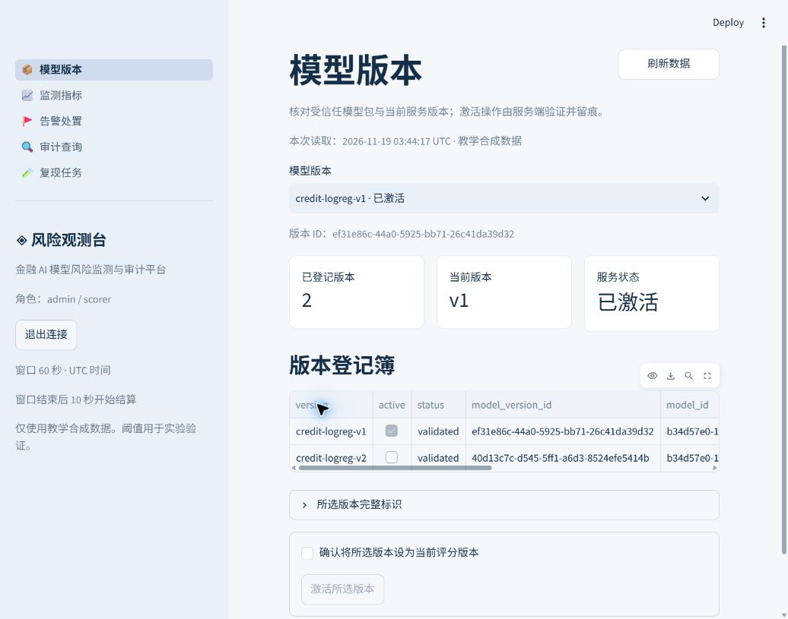
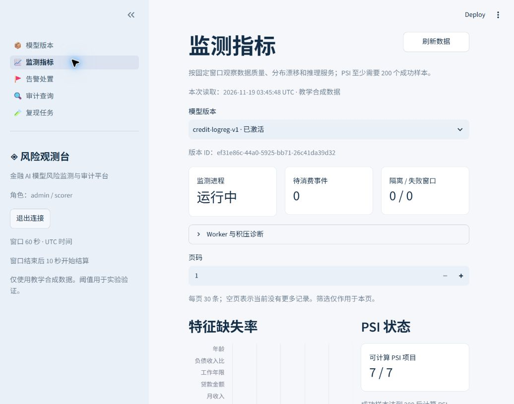
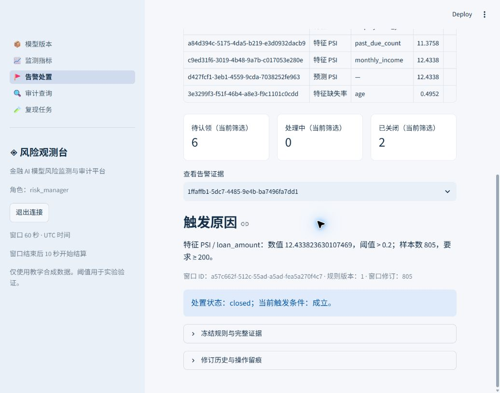

# 金融AI模型风险监测与审计平台软件需求说明书
版本 V1.5　2026-11-19

## 1 介绍

### 1.1 项目的目标

本项目面向金融科技与人工智能课程实验，围绕模拟信贷模型建立从版本登记、受控激活、评分留痕到风险监测和告警处置的业务流程。系统通过保存模型、输入、解释、监测窗口及规则版本，使一次评分结果与其后续风险信号能够关联核查。

本阶段汇总 A1 至 A5 与 B1 至 B5 的实现和设计交付。读者包括课程教师、模型开发人员、平台开发人员和实验验证人员。主要流程与后续可靠性扩展的状态分别在对应章节和第 17 章说明，文档用于核对输入输出、处理规则及验收条件。

### 1.2 项目的开发背景

信贷模型投入服务后，输入缺失、数据分布变化和推理故障会影响评分使用。仅保存最终概率难以解释模型当时使用的输入、版本和阈值。实验将这些问题转化为可复现的数据与软件需求，使用合成信贷样本、固定版本的逻辑回归模型和可追溯的监测记录展示完整处理过程。

系统使用中位数填补、标准化和逻辑回归组成的固定 Pipeline。解释采用特征在 log-odds 空间中的贡献，按绝对值选出前三项，随评分保存解释快照。监测结果以缺失率、PSI、推理失败率和推理耗时 P95 表达。

### 1.3 项目的范围

当前范围包括合成数据生成与校验、两版模型训练和加载校验、模型版本查询与激活、评分与原子留痕、持久事件消费、窗口指标、规则版本、告警认领与关闭，以及模型版本、监测指标、告警处置、审计查询与复现任务五个页面。

身份入口支持服务端配置的演示 Bearer 令牌与正式账号登录（见第 11 章），持久化使用可替换的 SQLite 适配器。评分审计、激活回执、规则变更和告警操作记录已保存。本文中的审计能力指这些已落地的记录与关联证据。

### 1.4 项目的用户特征

模型开发人员能够使用 Python 脚本生成数据、训练模型并检查版本包。管理员通过页面查看版本、激活模型，并查询监测进程状态和积压。获授权的评分调用方通过 HTTP API 提交合成特征并获取评分结果。具备管理权限的用户维护规则、认领告警和填写关闭说明。

当前演示管理员具有 admin 和 scorer 角色，演示评分用户具有 scorer 角色。后端同时核对角色与模型授权范围。scorer 可以读取授权模型的版本、指标、规则和告警，管理操作由后端进一步限制。risk_manager 的规则与告警权限已在服务端处理逻辑中支持。

## 2 假定与约束

### 2.1 数据约束

实验数据由固定随机种子产生，训练集 5000 条、测试集 1000 条、参考集 1000 条，以及正常、漂移、缺失评分流各 1000 条，总计 10000 条。缺失评分流中月收入缺失 100 条。数据清单记录文件摘要、行数和生成配置。

训练集用于拟合预处理和模型，测试集用于留出评估，参考集用于固定监测分箱。客户引用 customer_ref 和合成标签 synthetic_default_label 从特征列表中排除。线上监测以持久化评分事件及原始输入快照为数据来源。

### 2.2 模型约束

已交付版本为 credit-logreg-v1 和 credit-logreg-v2。两版使用相同特征顺序、预处理和 0.5 决策阈值，逻辑回归参数 C 分别为 1.0 和 0.5。版本目录中的模型、模式、参考分布、配置、环境和评估文件通过清单关联。

加载模型时先核对独立登记的受信任清单摘要、包内文件摘要和运行环境，再反序列化 Pipeline。模型包要求 CPython 3.12.14、Windows AMD64，以及包内列明的依赖版本。相同版本目录创建后保持固定。

### 2.3 时间与运行约束

评分按服务端受理时间进入 UTC 60 秒非重叠窗口，窗口采用左闭右开区间。窗口结束后保留 10 秒宽限，再由独立 Worker 结算。规则按窗口开始时间选择并冻结。迟到事件进入其原所属窗口，追加窗口修订并触发重算。

API、Worker 和页面分别运行。API 与 Worker 使用同一数据库和模型目录，页面通过配置的 API 地址交互。当前界面以手动刷新更新结果，每页展示 30 条记录，筛选与图表范围在页面中标明。

## 3 功能需求

### 3.1 合成数据准备

#### 3.1.1 功能描述

需求编号 FR01。系统应支持使用固定种子生成六组实验数据，并通过独立校验检查行数、字段、范围、缺失率、摘要和数据隔离关系。

#### 3.1.2 处理流程

执行数据生成脚本，分别输出训练、测试、参考和三类评分流。生成后写入 manifest，记录数据版本及摘要。执行校验脚本检查所有文件，并检查标签与客户引用没有进入模型特征。固定参数重复生成时，各文件内容应一致。

#### 3.1.3 其他规定

金额字段按人民币元记录为十进制字符串。评分流中的空字段在组装请求时转换为缺失值，原始输入和规范化输入分别保存。独立校验失败时应报告具体文件或字段，终止该次数据验收。

#### 3.1.4 参数说明

表 1  合成信贷特征参数

| 字段 | 含义 | 规范值与范围 | 单位 |
| --- | --- | --- | --- |
| age | 年龄 | 整数值，18 至 80 | 岁 |
| monthly_income | 月收入 | 十进制字符串，0 至 1000000，最多两位小数 | 元 |
| debt_income_ratio | 负债收入比 | 有限数值，0 至 3 | 比例 |
| past_due_count | 历史逾期次数 | 整数值，0 至 100 | 次 |
| loan_amount | 贷款金额 | 十进制字符串，0.01 至 10000000，最多两位小数 | 元 |
| employment_years | 工作年限 | 有限数值，0 至 60 | 年 |

六个特征均允许缺失，省略、null 和空字符串在当前规范化逻辑中归为缺失。布尔值、非有限数值、越界值、金额数值型输入和非约定字段应返回输入错误。customer_ref 为可选字符串，长度最多 128 个字符。

### 3.2 模型版本管理

#### 3.2.1 模型包登记与查询

需求编号 FR02。系统应加载受控脚本产生并已登记的模型包。API 启动时从受信任登记信息初始化版本元数据，查询接口仅返回调用者获授权的模型版本。

登记信息包括模型 ID、版本 ID、版本名称、清单摘要、验证状态和激活状态。模型目录包含 Pipeline、特征模式、训练配置、参考分布、解释配置、环境清单、评估和固定样例。包文件不完整、摘要不一致或环境不匹配时，校验应失败。

界面介绍见第 5.1 节。用户选择版本后可查看完整标识，核对版本名称、状态和清单摘要。

#### 3.2.2 模型激活

需求编号 FR03。管理员应能够在确认后激活受信任版本。请求输入为版本 UUID 和幂等键，后端检查管理员角色、模型授权和包有效性，再以同一事务更新激活指针、审计记录和激活回执。

成功激活返回 HTTP 200。相同身份在相同操作上使用同一幂等键和相同内容重试，应获取原回执。同键异内容返回 HTTP 409。激活失败时应保持持久化状态一致。新评分请求仅允许使用当前激活版本。

页面应禁用已激活版本的激活按钮。管理员须先勾选确认，再提交操作。收到成功提示后可刷新版本登记簿核对结果。

### 3.3 模拟评分与证据保存

#### 3.3.1 功能描述

需求编号 FR04。获授权的 scorer 应能够指定模型版本，提交六个合成特征并获取概率、阈值判断、解释及记录标识。接口应保存成功或终态推理失败的结果，支持幂等查询与重试。

#### 3.3.2 处理流程

第一步，记录请求受理时间并规范化输入，检查特征、客户引用、版本和授权。第二步，按身份、操作和幂等键查询已保存回执，核对规范请求摘要。第三步，对有效的新请求核对激活状态，加载固定模型并执行 Pipeline。第四步，计算解释并测量 predict_proba 推理耗时。第五步，在同一事务中写入输入快照、评分、初始审计和 outbox 完成事件。事务提交后返回结果。

#### 3.3.3 结果与异常

正常结果返回 HTTP 201，包含 prediction_id、模型版本、受理与完成时间、状态、risk_probability、阈值、决策、解释和推理时间。解释保留完整贡献及绝对贡献最大的三项。

参数不合法返回 422，未认证返回 401，权限不足返回 403，版本不存在返回 404，幂等冲突或非激活版本返回 409。已保存的终态推理失败返回 503，概率与决策等不可用字段保持空值。数据库不可写时返回存储不可用错误，调用方可用同一幂等键重试。

当前 INFERENCE_TIMEOUT_MS 默认 2000。该值在模型调用返回后检查，超时结果按失败保存。耗时度量仅覆盖约定的推理操作，关联的加载、HTTP 和事务时间由各自时间字段区分。

#### 3.3.4 参数说明

表 2  评分接口参数

| 参数 | 类型 | 约束或用途 |
| --- | --- | --- |
| model_version_id | UUID 字符串 | 指定已激活且获授权的版本 |
| input | JSON 对象 | 六个特征及可选 customer_ref |
| Authorization | HTTP 请求头 | Bearer 令牌，服务端解析身份 |
| Idempotency-Key | HTTP 请求头 | 长度 1 至 128，允许字母、数字、点、下划线、冒号和连字符 |

### 3.4 评分事件消费与恢复

#### 3.4.1 功能描述

需求编号 FR05。监测 Worker 应独立消费已保存的 prediction.completed 事件，支持去重、崩溃恢复、退避、隔离和带原因的人工重试。

#### 3.4.2 处理流程

Worker 认领事件时取得 30 秒租约和随机租约令牌。消费前检查事件模式、事件内容、评分结果和原始快照的一致性，随后以短事务写入消费标记、窗口计数、窗口修订及完成状态。重复事件应只产生一份逻辑消费结果。

统计阶段在事务外计算指标，再通过窗口修订比较更新持久结果。发布时将指标、指标修订、告警、告警修订及已计算修订号一并提交。事件已消费而统计未完成时，后续轮询应继续处理脏窗口。

#### 3.4.3 其他规定

单轮默认最多消费 100 个事件、计算 20 个窗口。空闲时轮询间隔为 2 秒，单轮满批后连续处理下一批，每个事件事务之间让出 20 毫秒。失败最多尝试 5 次，采用 1、2、4、8 秒退避，超限事件进入 dead_letter，失败窗口进入 calculation_failed。人工重试保留原因、先前错误和尝试次数。

Worker 状态查询返回心跳、队列计数、待计算与失败窗口及隔离任务信息。最近完成轮询的心跳在 15 秒内显示 fresh，过期显示 stale，尚无心跳时显示 never_started。

### 3.5 窗口指标监测

#### 3.5.1 功能描述

需求编号 FR06。系统应按模型版本和固定窗口计算缺失率、特征 PSI、预测 PSI、推理失败率与推理耗时 P95，并保存计算状态、样本数、单位、参考摘要和修订信息。

#### 3.5.2 参数与统计口径

表 3  监测指标统计口径

| 指标 | 计算口径 | 样本与状态 | 单位 |
| --- | --- | --- | --- |
| 特征缺失率 | 成功评分中原始特征缺失条数除以成功评分数 | 六个特征分别统计 | 比例 |
| 特征 PSI | 评分特征分布与固定参考分布逐箱比较 | 成功样本至少 200 条 | 指数 |
| 预测 PSI | 成功评分概率分布与固定参考概率分布比较 | 成功样本至少 200 条 | 指数 |
| 推理失败率 | 已尝试推理的失败数除以尝试总数 | 加载模型前失败按未尝试处理 | 比例 |
| 推理耗时 P95 | 成功评分的 predict_proba 耗时第 95 百分位 | 使用线性分位数方法 | 毫秒 |

每个窗口保存 15 项指标，分别为六项缺失率、六项特征 PSI、一项预测 PSI、一项失败率和一项 P95。PSI 使用模型包固定分箱、缺失箱和 0.000001 平滑量，平滑后重新归一化。处在分箱切点上的值划入右侧箱。

#### 3.5.3 状态与修订

有效结果标记为 ready，样本不足标记为 insufficient_samples，分母无数据时记录 no_data。不可计算的值保持空值。接口应同时提供窗口最新修订和指标已计算修订。

存在未消费的本窗口事件，或指标修订落后于最新窗口修订时，stale 应为真。页面应提示待更新，并从有效趋势点中排除这些记录。迟到样本触发同一窗口重算，保留先前修订，并沿用原窗口冻结的规则。

#### 3.5.4 界面介绍

监测页上方显示进程状态、待消费事件和隔离或失败窗口。中部以条形图展示本页最新窗口的各特征缺失率，并展示 PSI 项目的可计算状态。下方显示窗口指标表、单序列趋势和规则版本。用户可展开统计详情检查计算版本和参考清单摘要。

### 3.6 监测规则配置

#### 3.6.1 功能描述

需求编号 FR07。admin 或 risk_manager 应能够为获授权模型创建追加的规则版本，查询接口应保留规则历史。默认规则与版本模型初始化后可直接用于监测。

#### 3.6.2 处理流程

用户选择指标与适用特征，输入阈值、最少样本数和未来 UTC 整分钟生效时间。后端检查角色、模型范围和字段约束，根据模型版本、指标和特征生成递增规则版本，并以同一事务保存规则、审计和幂等回执。

#### 3.6.3 参数说明

缺失率与特征 PSI 必须指定六个特征之一，整体指标使用空特征。比例阈值范围为 0 至 1，其他阈值为有限非负数。最少样本数范围为 1 至 100000，PSI 至少为 200。生效时间必须带时区并落在未来 UTC 整分钟。

默认教学阈值分别为缺失率大于 0.05、PSI 大于 0.2、失败率大于 0.01、推理耗时 P95 大于 500 毫秒。所有告警比较均为严格大于，并同时满足样本下限。

### 3.7 告警生成与处置

#### 3.7.1 功能描述

需求编号 FR08。系统应根据窗口指标和冻结规则生成告警，保存触发数值、样本数、规则快照和窗口修订。管理用户应能够认领告警，并在填写说明后关闭告警。

#### 3.7.2 处理流程

Worker 判断指标状态为 ready、样本数达到规则要求且数值严格大于阈值时创建 open 告警。告警按窗口和规则唯一。管理用户执行认领后，状态变为 acknowledged，并保存责任人与动作记录。管理员或该告警认领人提交非空说明后，状态变为 closed。

#### 3.7.3 其他规定

人工动作、状态更新、审计和幂等回执保持事务一致。重复提交同一命令返回原回执，非法状态流转返回 409，缺少关闭说明返回 422。告警详情应展示最多 100 条修订和 100 条动作记录。

迟到数据可能改变 condition_active，人工处置状态继续保留。已关闭告警的触发条件变化通过修订历史表达，后续窗口按其自身规则生成新的告警。

#### 3.7.4 界面介绍

告警页面提供版本、页码和状态筛选，展示当前筛选结果的待认领、处理中、已关闭数量。选中告警后，页面列出指标、特征、实际数值、阈值、样本数、样本要求、规则版本、窗口标识和修订。证据区可展开冻结规则及完整记录，管理用户通过表单认领或关闭。

### 3.8 访问与会话管理

需求编号 FR09。用户通过密码型输入框提交服务端已配置的演示令牌。页面调用身份接口验证后进入模型、监测和告警页面，每次重绘重新获取服务端身份。退出时清空当前会话。

令牌在 Streamlit 当前服务端会话中使用。API 地址由服务端环境变量提供。客户端设置有限网络超时，禁用自动跟随重定向，POST 使用显式幂等键。网络结果未知时保留当前命令键，收到成功回执后结束该命令，后续主动操作生成新键。

## 4 性能需求

### 4.1 处理与查询边界

当前查询接口默认每页 20 条，单页最大 100 条，页面使用每页 30 条。版本切换、指标筛选和分页均通过既有 API 或已读取的当前页数据完成。图表按页面标注的数据范围显示。

评分请求中执行模型推理和证据事务，监测在独立进程消费完成事件。数据库可用时，Worker 暂停期间产生的评分事件保持持久化，Worker 恢复后继续消费。该分工由进程恢复和事务故障注入测试覆盖。

### 4.2 时间参数

已实现的时间控制包括 60 秒监测窗口、10 秒结算宽限、默认 2 秒 Worker 轮询、30 秒事件租约、15 秒心跳新鲜度，以及默认 2000 毫秒的推理返回后超时检查。页面 HTTP 客户端的总超时为 10 秒，连接超时为 3 秒。

本组采用真实系统时钟验证最终版本的监测时效。历史独立演示中的测试时钟只用于确定性功能测试，本版负载与窗口结算结果均取自真实 HTTP 和独立 Worker 的运行记录。

## 5 用户界面和接口需求

### 5.1 模型版本界面

界面展示已登记版本数、所选版本、服务状态和版本登记簿。版本名称、激活状态、验证状态及完整标识应可查看。页面以管理员角色控制激活表单的呈现，并由 API 完成最终授权。激活时要求勾选确认，成功提示与刷新入口应清晰可见。

### 5.2 监测指标界面

界面展示监测进程、积压、缺失率条形图、PSI 可计算状态、窗口指标明细、趋势和规则表。原始 API 比例在表格中使用 0 至 1 表示，缺失率图使用百分比刻度。空指标保持空值，样本不足和待更新信息应显示。规则表优先呈现指标、特征、版本、阈值、样本下限和生效时间。

### 5.3 告警处置界面

界面将触发证据与人工处置状态共同展示。状态筛选和数量卡片标注为当前筛选，告警详情提供完整规则快照和操作历史。关闭表单要求填写说明。页面以“当前触发条件”和“处置状态”表达两个独立字段。

### 5.4 HTTP 接口

表 4  业务 HTTP 接口

| 方法 | 路径 | 主要能力 |
| --- | --- | --- |
| GET | /health | 数据库可达性检查 |
| GET | /api/v1/me | 当前身份、角色和模型授权 |
| GET | /api/v1/model-versions | 授权版本列表 |
| POST | /api/v1/model-versions/{id}/activate | 版本验证与激活 |
| POST | /api/v1/predictions | 评分与原子留痕 |
| GET | /api/v1/metrics | 窗口指标分页查询 |
| GET 或 POST | /api/v1/monitor-rules | 查询或创建规则版本 |
| GET | /api/v1/alerts | 告警分页查询 |
| GET | /api/v1/alerts/{id} | 告警证据、修订和动作 |
| POST | /api/v1/alerts/{id}/acknowledge | 认领告警 |
| POST | /api/v1/alerts/{id}/close | 关闭告警 |
| GET | /api/v1/monitor/status | 管理员查询进程与积压 |

健康检查和登录允许匿名访问，受保护接口检查 Bearer 身份、角色和模型范围。命令键按接口契约校验；复现创建同键同内容返回原任务，不同键的活动任务冲突返回 409。接口文档为 /docs 和 /openapi.json。

## 6 软硬件环境需求

### 6.1 软件环境

模型运行环境为 CPython 3.12.14、Windows AMD64。主要锁定依赖包括 scikit-learn 1.9.1、NumPy 2.5.4、SciPy 1.18.1、joblib 1.6.0、FastAPI 0.162.0、SQLAlchemy 2.0.57、httpx 0.28.1、Streamlit 1.66.1、pandas 3.1.1 和 Altair 6.3.0。完整清单见 requirements-a5.lock.txt，模型包内另附环境约束。

API 通过 Uvicorn 启动，Worker 通过独立 Python 进程启动，页面通过根目录 streamlit_app.py 启动。浏览器需支持现代 JavaScript、表格和 Vega-Lite 图形渲染。

### 6.2 文件与运行配置

artifacts 目录保存固定版本模型包，data/synthetic/v1 保存合成样本，data/runtime 保存本地运行数据库与演示配置，evidence 保存验证记录。配置通过 DATABASE_URL、ARTIFACT_ROOT、APP_ADMIN_TOKEN、APP_SCORER_TOKEN、INFERENCE_TIMEOUT_MS 和 API_BASE_URL 环境变量提供。

管理员与 scorer 令牌各至少 32 字符且互不相同。运行目录可写，模型包目录可读，API 与 Worker 对同一数据库访问。复验脚本可创建隔离运行目录，分别启动本地 API、Worker 和页面。

## 7 质量需求

### 7.1 正确性

特征顺序、预处理、阈值、参考分箱与解释配置由固定模型包决定。指标按版本和 UTC 窗口隔离。评分、激活、规则、告警及复现创建按幂等回执处理重复请求；原始缺失率、推理失败率和 PSI 样本下限分别按对应接口与统计要求验收。

### 7.2 健壮性

非法字段、越界值、无效 UUID 和非法幂等键应返回可识别错误。模型包缺失、摘要改变、环境不符、推理故障和存储错误应进入明确的失败路径。页面应展示认证、权限、冲突、参数及服务错误提示。

### 7.3 可靠性

评分证据和完成事件应同事务保存。租约令牌应阻止旧消费者覆盖已被重新认领的工作，消费检查点和窗口修订应支持中断后继续计算。失败重试应有限次，隔离任务应可定位，人工恢复应附原因和历史错误。

### 7.4 易用性与清晰性

页面应使用中文业务标签，提供版本选择、刷新、分页、状态筛选和证据展开入口。监测页应以图表与明细同时展示数值、样本和状态。告警页应显示触发比较、规则版本和处置说明。

### 7.5 访问安全

所有业务请求应由后端校验身份与模型范围。管理员管理版本与模型授权，admin 或 risk_manager 管理规则与告警，scorer 在授权模型内调用评分并读取允许的数据，审计人员在授权范围内查询证据、发起复现并导出报告。令牌字段使用密码型控件，本地凭据和运行数据库放入忽略的运行目录。正式身份、授权执行与令牌规则见第 11 章。

### 7.6 可维护性与兼容性

身份、预测存储和监测存储通过适配器边界关联服务。模型包以清单和依赖锁支持环境复现。A4 在既有 A3 outbox 上增加租约令牌列，通过增量初始化兼容旧库。指标、规则与告警修订保存版本信息，支持沿历史记录核对。

## 8 附录 A 已实现需求与验证对应

表 5  需求与验证对应

| 需求编号 | 已实现功能 | 主要实现位置 | 验证依据 |
| --- | --- | --- | --- |
| FR01 | 合成数据生成与校验 | scripts/generate_data.py 与 validate_data.py | test_data_preparation.py |
| FR02 | 固定模型包与版本查询 | app/modules/models 与 app/main.py | test_model_package.py |
| FR03 | 管理员激活与幂等回执 | app/modules/scoring/service.py | test_scoring_api.py |
| FR04 | 评分与事务留痕 | app/modules/scoring 与 app/storage | test_scoring_api.py |
| FR05 | 事件租约、去重与恢复 | app/worker.py 与 monitoring/store.py | test_monitoring_worker.py |
| FR06 | 窗口指标与迟到修订 | app/modules/monitoring | test_monitoring_worker.py |
| FR07 | 规则版本与生效边界 | app/modules/alerts/commands.py | test_monitoring_worker.py |
| FR08 | 告警、认领和关闭 | app/modules/alerts 与 ui/pages/alerts.py | Worker API 测试与页面测试 |
| FR09 | 令牌会话与角色展示 | app/demo_auth.py 与 ui/app.py | test_ui.py |
| FR10 | 登录与令牌签发 | app/auth/service.py 与 tokens.py | test_auth.py |

需求与验证对应续表

表 6  需求与验证对应续表

| 需求编号 | 已实现功能 | 主要实现位置 | 验证依据 |
| --- | --- | --- | --- |
| FR11 | 角色与模型授权 | app/auth/store.py 与 routes.py | test_auth.py |
| FR12 | 服务端授权执行 | app/auth/service.py 与 app/main.py | test_auth.py |
| FR13 | 评分证据查询 | app/modules/audit/service.py | test_audit_replay.py |
| FR14 | 审计记录检索 | app/modules/audit/service.py 与 routes.py | test_audit_replay.py |
| FR15 | 审计导出（单条证据） | app/modules/audit/service.py | test_audit_replay.py |
| FR16 | 复现任务创建 | app/modules/replay/service.py | test_audit_replay.py |
| FR17 | 复现执行与比对 | app/modules/replay/service.py 与 app/worker.py | test_audit_replay.py、test_replay_real.py |
| FR18 | 审计页面 | ui/pages/audit.py | test_ui_audit_replay.py |
| FR19 | 复现页面 | ui/pages/replay.py | test_ui_audit_replay.py |

本组对整合版本执行 158 项自动化测试，全部通过；真实 HTTP、负载、ASR、浏览器及进程恢复结果见材料依据/最终整合验收。历史测试记录按原版本保留。

模型 v1 在 1000 条合成测试样本上的 ROC AUC 为 0.797800，准确率为 0.786，召回率为 0.366795。这些指标来自固定留出评估。窗口监测按照缺失率、分布漂移及运行指标展示当前评分流状态。

## 9 附录 B 当前界面

### 9.1 模型版本

图 1  模型版本界面

### 9.2 监测指标

图 2  监测指标界面

### 9.3 告警处置

图 3  告警处置界面

## 10 双人合作与交接

### 10.1 成员职责与当前进度

成员 A 负责合成数据、固定模型、评分解释、监测算法、规则与告警、模型和监测页面，完成业务架构、逻辑架构及一级数据流图。A1—A5 的实现作为整合版本的模型监测基础。

成员 B 负责账号、角色与模型授权、审计详情和导出、历史复现任务、审计与复现页面，完成数据、技术和部署架构。B1—B5 与 A 部分合并后通过 158 项回归及本次真实场景验证。

成员 A 实现 SQLite 存储、模型评分和监测链路，成员 B 基于共享接口实现正式身份认证、审计查询与导出、历史评分复现。两部分共用模型版本标识、评分编号和数据库事务边界，通过接口联调及交叉回归验证集成结果。

### 10.2 交付材料与接口交接

A 部分提供六组合成数据、两个固定模型包、特征和解释模式、评分样例、错误分类、事务和事件契约、窗口与规则口径。整合时核对模型环境、样例概率、原始缺失信息及关联编号。

正式身份适配器返回服务端 Principal，包含 principal_id、roles 和 model_ids。当前身份查询接口继续向页面提供这些字段。预测存储和监测存储共同关联评分、快照、审计、outbox、消费标记、窗口修订和回执，替换适配器时核对旧库兼容。

B 部分提供证据查询、JSON/CSV 单条导出和复现接口。双方核对历史版本、原始输入、阈值、解释和概率的关联一致性；复现使用原模型包重新推理，将概率误差与判断一致性写入独立任务记录。

### 10.3 实施顺序与文件协作

本组仓库为 Cherable/financial-ai-model-risk-platform。成员 A 使用 A/model-monitoring，成员 B 使用 B/audit-platform；最终整合分支为 integration/final-20261119，合作基线 26d1e4b 已包含双方实现，核心整合代码为 ab72dd8。

共享契约、应用工厂、SQLAlchemy 元数据、配置、依赖锁和需求说明书随任务主责修改，并在交叉检查中核对调用方与持久化行为。模型、参考分箱与统计问题由 A 主修，正式身份、审计和复现组织问题由 B 主修。

### 10.4 共同验收与记录

共同验收包括正常评分、幂等与故障、Worker 暂停恢复、缺失与 PSI 样本下限、规则生效与迟到修订、告警认领关闭、正式权限及历史复现。自动化用例与真实场景记录共同核对模型、统计、授权、事务和证据关系。

本组完成 FR01—FR19 的实现与验证，158 项自动化测试全部通过。实测覆盖身份权限、评分与回执、审计导出、监测告警、浏览器操作、并发负载及进程恢复。实验范围为 Windows 单机、合成信贷数据和固定模型；跨机高可用及批量导出不属于本版范围。

验证记录关联代码提交、执行命令、环境、时间、请求编号和结果文件。整合版本保存完整逐项日志、负载原始样本及页面截图，各项结论均可追溯至对应记录。

## 11 身份与访问控制

第 11 至 16 章覆盖正式身份、审计与复现。FR10 至 FR19 已通过主要流程、回执冲突、中断恢复及页面验收。详细证据与运行边界见第 17 章。

系统已实现正式账号、数据库角色和模型范围授权，使用 Argon2id 与短期 JWT，并保留原演示 Bearer 入口。配置 JWT_SECRET 后启用正式认证，授权记录按请求从数据库核对。

### 11.1 登录与令牌签发

#### 11.1.1 功能描述

需求编号 FR10。系统应支持用户名与密码登录，校验通过后签发短期访问令牌，令牌只携带用户标识，不携带角色与模型授权。

#### 11.1.2 处理流程

第一步，接收用户名与密码，两者均不得为空。第二步，按用户名查询用户记录，用户不存在或状态不是 active 时统一返回认证失败。第三步，使用 Argon2id 校验密码哈希。第四步，校验通过后签发 JWT，载荷仅含 user_id、issued_at、expires_at 和令牌编号，有效期 30 分钟。第五步，写入登录成功审计记录；失败时写入失败审计，记录用户名与来源，不记录密码。

#### 11.1.3 结果与异常

成功返回 HTTP 200，包含 access_token、token_type、expires_at。用户名不存在与密码错误返回同一错误码 UNAUTHENTICATED 与同一提示文案，避免用户名枚举。账号被停用返回相同错误。请求格式错误返回 422。

账户连续失败不锁定（原型范围），但失败次数写入审计，供后续扩展。

#### 11.1.4 参数说明

表 7  登录与认证参数

| 参数 | 类型 | 约束或用途 |
| --- | --- | --- |
| username | 字符串 | 1—64 字符，必填 |
| password | 字符串 | 1—128 字符，必填，仅用于校验，不落库不落日志 |
| Authorization | HTTP 请求头 | 后续请求携带 Bearer <token> |

#### 11.1.5 验收条件

未携带令牌返回 401；错误密码与不存在的用户名返回相同响应体；日志与截图不出现密码或完整令牌；令牌过期后返回 401。

### 11.2 角色与模型授权

#### 11.2.1 功能描述

需求编号 FR11。系统应支持四类角色与按模型的访问授权，授权变更由管理员执行并留痕。

#### 11.2.2 角色定义

表 8  角色与操作权限

| 角色代码 | 名称 | 可执行操作 |
| --- | --- | --- |
| model_developer | 模型开发人员 | 查看获授权模型的版本、元数据、指标与解释 |
| risk_manager | 风险管理人员 | 查看指标，为获授权模型创建规则，认领与关闭告警 |
| auditor | 审计人员 | 查询获授权范围内的评分证据，发起复现，导出审计报告；不可修改任何原始记录 |
| admin | 管理员 | 管理用户与授权，执行版本激活；全部操作写审计 |

角色是固定枚举，不提供自定义角色。四类角色与文档 01 第 2 节一致。

#### 11.2.3 模型授权

授权记录粒度到 model_id 而非 model_version_id：授权一次覆盖该模型后续全部版本，避免每发布一个版本都要重新授权。管理员可授予与撤销；撤销即时生效，不影响已产生的历史记录。

#### 11.2.4 处理流程

管理员提交用户标识、模型标识与动作（授予/撤销）。后端校验管理员角色，写入或删除 model_access 记录，同事务写入 audit_logs。用户状态变更（启用/停用）同样流程。

#### 11.2.5 验收条件

未登录访问管理接口返回 401；非管理员调用返回 403；授权变更后重新登录可见新范围，未重新登录的旧令牌也立即受新范围约束（见 11.3）；授权变更在审计记录中可查。

### 11.3 服务端授权执行

#### 11.3.1 功能描述

需求编号 FR12。所有业务请求的身份与授权在后端校验，页面隐藏按钮不构成授权。

#### 11.3.2 处理流程

第一步，解析 Authorization 头，校验签名与过期时间，得到 user_id。第二步，按 user_id 从数据库读取当前角色集合与模型授权集合——角色不从令牌读取，因此角色变更与授权撤销对已签发且未过期的令牌立即生效，伪造或篡改令牌载荷无法提权。第三步，校验用户状态为 active。第四步，按接口要求校验角色，再按请求涉及的 model_id 校验模型授权。

#### 11.3.3 结果与异常

未认证（缺失、格式错误、签名无效、已过期）返回 401；已认证但角色或模型范围不足返回 403；资源不存在返回 404。三种情况不混用。

#### 11.3.4 设计取舍

每次请求查询一次用户与授权，换取"权限变更立即生效"。代价是每请求多一次索引查询；在单机 SQLite 量级下可接受。若后续改为在令牌中携带角色，必须在令牌中增加版本号并在变更时使旧版本失效，否则会出现最高 30 分钟的权限窗口期。

#### 11.3.5 验收条件

直接以 HTTP 调用接口（绕过页面）时授权同样生效；篡改请求体中的角色或用户字段不改变实际权限；普通模型人员访问审计导出接口返回 403；停用账号的未过期令牌返回 401。

## 12 审计查询与导出

### 12.1 评分证据查询

#### 12.1.1 功能描述

需求编号 FR13。授权用户应能通过评分编号查询一次评分的完整证据链：输入、模型版本、阈值、解释、耗时、状态与后续处置。

#### 12.1.2 处理流程

第一步，校验身份与模型范围（该评分所属 model_id 必须在授权范围内）。第二步，按 prediction_id 联查 predictions、input_snapshots、model_versions、关联 alerts 与处置动作。第三步，返回证据视图。第四步，在 audit_logs 写入一条详情查询记录，包含查询人、被查编号与时间。

#### 12.1.3 结果内容

返回内容包括：评分编号、模型与版本标识、请求受理与完成时间、原始输入与规范化输入、缺失字段列表、风险概率、决策阈值与判断、解释快照（全部贡献与前三项）、推理耗时、状态与错误码、以及该评分关联的告警与处置记录。

原始输入只对具备审计权限的角色返回；model_developer 与 risk_manager 看到的版本不含完整原始输入，仅含统计与指标信息。

#### 12.1.4 异常

评分不存在返回 404；评分存在但模型不在授权范围返回 403；数据库不可用返回 503。

#### 12.1.5 验收条件

能从一个 prediction_id 找到完整证据；越权查询被阻止；每次详情查询在审计记录中留下痕迹。

### 12.2 审计记录检索

#### 12.2.1 功能描述

需求编号 FR14。授权用户应能按模型、时间范围与结果状态分页检索评分记录。

#### 12.2.2 参数说明

表 9  审计检索参数

| 参数 | 类型 | 约束或用途 |
| --- | --- | --- |
| model_version_id | UUID 字符串 | 可选，限定版本 |
| from / to | UTC ISO 8601 | 时间范围，必填，跨度不超过 31 天 |
| status | 枚举 | 可选，success / failed |
| offset / limit | 整数 | limit 默认 20，最大 100 |

时间范围强制要求，避免无界全表扫描。排序按 request_received_at 倒序，同一时间按 prediction_id 稳定排序。

#### 12.2.3 结果与异常

返回分页条目与总数。模型不在授权范围返回 403；时间范围缺失或超过 31 天返回 422；limit 超限返回 422。

#### 12.2.4 验收条件

分页边界正确（最后一页与空结果）；超范围时间返回 422；不同角色看到的条目范围与授权一致。

### 12.3 审计导出

#### 12.3.1 功能描述

需求编号 FR15。授权用户应能将一条评分的完整证据导出为 JSON 或 CSV，导出动作本身留痕。导出路径按 docs/04 第 6 节冻结的接口为 GET /audit/records/{prediction_id}/export。

#### 12.3.2 处理流程

第一步，校验身份、角色与模型范围，且必须校验到该评分所属模型。第二步，按评分编号重新读取证据，不复用页面已检索的缓存，避免导出与授权状态不一致。第三步，生成文件，内容包含来源记录编号与生成时间。第四步，写入 audit_exports（被导出编号、格式、行数、文件摘要、导出人、时间）与 audit_logs。第五步，返回文件流。

#### 12.3.3 参数说明

表 10  审计导出参数

| 参数 | 类型 | 约束或用途 |
| --- | --- | --- |
| prediction_id | UUID 字符串 | 路径参数，被导出的评分编号 |
| format | 枚举 | 查询参数，json / csv，默认 json |

#### 12.3.4 内容要求

导出内容包含来源记录编号 prediction_id 与生成时间 UTC，CSV 使用带 BOM 的 UTF-8。审计导出接口要求 auditor 或 admin 角色及对应模型授权，其他角色直接调用返回 403。导出字段范围以服务端证据查询结果为准。

#### 12.3.5 批量导出（扩展，不在当前契约内）

审计导出以单条评分证据为单位，按 prediction_id 定位并生成 JSON 或 CSV 文件。按筛选条件批量导出不属于当前系统范围。

#### 12.3.6 验收条件

导出内容与数据库记录逐条一致；越权导出被阻止；导出记录可查且文件摘要可用于核对；非授权角色看不到原始输入字段。

## 13 历史评分复现

### 13.1 复现任务创建

#### 13.1.1 功能描述

需求编号 FR16。审计人员应能对一条历史评分发起复现任务。任务由现有单 worker 按类型分派执行，不新增进程。

#### 13.1.2 处理流程

第一步，校验身份、角色与模型范围。第二步，在写事务中按操作者和幂等键查询回执；同键同评分返回原任务。第三步，以原评分的 model_version_id 创建 pending 任务，不接受调用方指定版本。第四步，将 replay.requested 回执与任务同事务提交。第五步，返回任务标识并支持状态查询。

#### 13.1.3 参数说明

表 11  复现创建参数

| 参数 | 类型 | 约束或用途 |
| --- | --- | --- |
| prediction_id | UUID 字符串 | 被复现的评分编号 |

#### 13.1.4 异常

原评分不存在返回 404，模型不在授权范围返回 403。同操作者同幂等键及同评分编号返回原任务；同键异评分编号返回 409 IDEMPOTENCY_CONFLICT。不同键在同一评分存在 pending/running 任务时返回 409 REPLAY_ALREADY_RUNNING。回执随 replay.requested 审计记录与任务同事务保存。

### 13.2 复现执行与比对

#### 13.2.1 功能描述

需求编号 FR17。Worker 加载原版本模型包，使用原输入重新推理，与原结果比较并保存结论。缺少模型文件、摘要不匹配或环境不符时明确失败，禁止用当前激活版本替代历史模型。

#### 13.2.2 处理流程

第一步，领取 pending 任务并置 running。第二步，核对原模型清单、文件摘要及运行环境，失败时保存原因。第三步，使用原始输入与原版本 Pipeline 重新推理，复用相同规范化处理。第四步，计算概率绝对误差并比较阈值判断。第五步，保存 passed、mismatch 或 failed 及相关结果。第六步，写入终态审计记录。

#### 13.2.3 结果与判定

表 12  复现结果判定

| 结果 | 含义 | 记录字段 |
| --- | --- | --- |
| passed | 误差 ≤1e-8 且阈值判断一致 | absolute_error、decision_match=1 |
| mismatch | 计算成功但不一致 | absolute_error、decision_match 实际值 |
| failed | 无法完成计算（包缺失、摘要不符、环境不符、错误） | failure_reason 非空 |

mismatch 与 failed 必须分开：前者说明计算确实做了但结果不同（可能是软件行为差异），后者说明根本没有得到可信计算。混为一谈会掩盖真正的问题。

#### 13.2.4 其他规定

原评分为失败记录时不计算概率误差，复现记录是否再次出现推理失败。成功评分复现保存原概率、新概率、绝对误差与判断一致性；原始解释快照继续由评分证据保存，当前任务不另存一份复现解释。

#### 13.2.5 验收条件

切换激活版本后仍可复现旧记录；原版本包被移动或篡改时明确失败且写明原因；复现结果与原始记录分别保存，历史记录不被覆盖；同一评分并发发起两次只产生一个任务。

## 14 审计与复现页面

### 14.1 审计页面

需求编号 FR18。页面提供模型、时间范围和状态筛选、分页列表、证据详情与导出入口。导出以当前选中的一条评分为单位，提供 JSON、CSV 和文件 SHA-256 摘要；文件中的 exported_at 记录生成时间，导出行为写入审计。

页面不展示密码、令牌或完整存储路径。原始输入展示前提示为合成演示数据。

### 14.2 复现页面

需求编号 FR19。页面从评分证据直接跳转发起复现，显示任务状态、原概率、新概率、绝对误差、判断是否一致与失败原因。任务未完成时显示进行中并允许手动刷新；失败时显示具体原因，不提供"用当前模型试算"的入口。

## 15 质量需求

### 15.1 安全

密码使用 Argon2id 哈希，不存明文、不落日志。令牌使用独立密钥签名，密钥不提交仓库。日志与错误响应不包含令牌、密码、完整原始输入或绝对路径。页面隐藏按钮不作为授权依据。数据库文件与 .env 不纳入版本控制。

### 15.2 可靠性

监测事件保留租约与隔离机制。历史复现采用单 Worker 部署，启动时将中断的 running 任务恢复为 pending 并写入 replay.recovered 审计记录。本轮已通过强制终止领取任务的进程、重启真实 Worker、核对误差为 0 的恢复实验。

### 15.3 性能与容量

检索采用时间范围与分页，单条导出按 prediction_id 定位。复现异步执行，任务保存创建和完成时间及环境核验结果。模型加载复用已核验字节，避免重复打开文件；复现回执由数据库条件查询，不在应用中遍历全部历史回执。

### 15.4 可维护性

身份与存储通过 app/contracts.py 的 Authenticator 与 PredictionStore 协议接入，替换实现不改上层代码。新增表沿用现有 metadata 与增量列迁移方式，旧库升级不清空评分数据。

## 16 需求—ASR—验收对应

表 13  需求与架构验收对应

| 需求编号 | 名称 | 对应 ASR | 验收清单项 | 可复用验证 |
| --- | --- | --- | --- | --- |
| FR10 | 登录与令牌签发 | ASR-04 | T11 | 接口测试：未登录、错误密码、过期令牌 |
| FR11 | 角色与模型授权 | ASR-04 | T11 | 授权变更后权限生效 |
| FR12 | 服务端授权执行 | ASR-04 | T11 | 直接 HTTP 调用绕过页面 |
| FR13 | 评分证据查询 | ASR-03 | T10、T12 | 按编号查完整证据；越权被拒 |
| FR14 | 审计记录检索 | ASR-03 | T12 | 分页与时间范围约束 |
| FR15 | 审计导出 | ASR-03、ASR-04 | T11、T12 | 导出一致性；越权被拒 |
| FR16 | 复现任务创建 | ASR-03 | T10 | 固定版本；同键回执；活动任务冲突 |
| FR17 | 复现执行与比对 | ASR-03 | T10 | 切换版本后复现；包缺失失败 |
| FR18 | 审计页面 | 易用性 | UI 测试 | test_ui_audit_replay.py |
| FR19 | 复现页面 | 易用性 | UI 测试 | test_ui_audit_replay.py |

## 17 综合验收与当前限制

### 17.1 版本基线和证据

本说明书 V1.5 对应本组 2026 年 11 月 19 日最终整合版本。合作基线为 B/audit-platform 的 26d1e4b，包含 A/model-monitoring 的实现；核心代码版本为 ab72dd8，最终分支为 integration/final-20261119。

158 项自动化测试全部通过，失败、错误与跳过均为 0。用例包括远程慢时钟并发冲突、完成后回执、键内容冲突、中断恢复、同键并发和校验后文件变化；逐项日志见 regression-158.log。

### 17.2 验收结果与运行边界

历史复现固定使用原模型包、原始输入和原环境。单 Worker 启动时将遗留 running 任务重置为 pending，并写入 replay.recovered 审计记录；旧进程必须先退出，禁止多实例同时部署。本轮隔离库实验通过进程领取、强制终止、真实 Worker 重启验证任务最终 passed，绝对误差为 0，恢复审计记录为 1 条。

复现创建回执已实现并验收：以操作者和幂等键匹配 replay.requested 记录，评分编号作为规范化请求内容。同键同内容返回原任务的当前状态，同键异内容返回 409。任务、回执与审计同事务写入；查询前仍核验角色和模型授权。本轮验证终态任务重复请求返回相同任务编号。

本组在预热后完成 5 并发 500 次真实 HTTP 评分，端到端 P95 为 70.4 ms；三轮 20 并发各 100 次评分的 P95 分别为 233.7、258.5、248.6 ms，三轮总体 P95 为 249.6 ms。800 次请求全部成功，错误率为 0。对应新窗口在结束后 10.342 秒完成结算，事件积压为 0。上述结果满足本次单机合成数据场景的 500 ms 与 15 秒目标。 两个版本各 10 条评分复现全部通过；Worker 停止期间 100 条评分正常提交，恢复后无重复消费。五个页面及角色隔离均完成浏览器验证。

### 17.3 交付范围

本版包含课程实验报告、软件需求说明书 V1.5 和版本化验证材料。本组完成 FR01—FR19 的实现与验证，158 项自动化测试全部通过。实测覆盖身份权限、评分与回执、审计导出、监测告警、浏览器操作、并发负载及进程恢复。实验范围为 Windows 单机、合成信贷数据和固定模型；跨机高可用及批量导出不属于本版范围。

材料依据/材料索引.md 关联代码提交、设计资料与文件 SHA-256。完整字段字典位于设计资料/B1-数据架构与数据字典.md；接口、错误码及技术部署说明按整合后的实现统一。

材料依据/最终整合验收保存 live-results.json、load-results.json、asr-results.json、recovery-results.json、browser-acceptance.json、六张页面截图和 regression-158.log。全部请求样本与对应版本保留在记录中。
