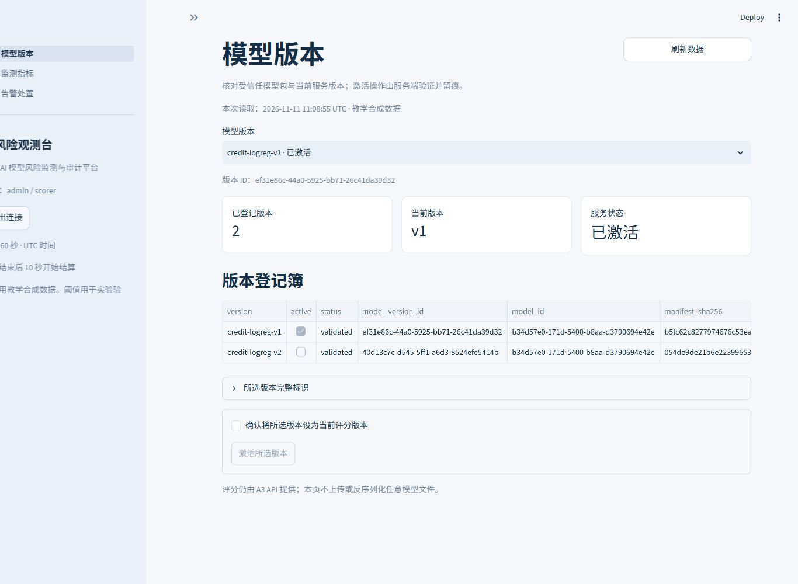
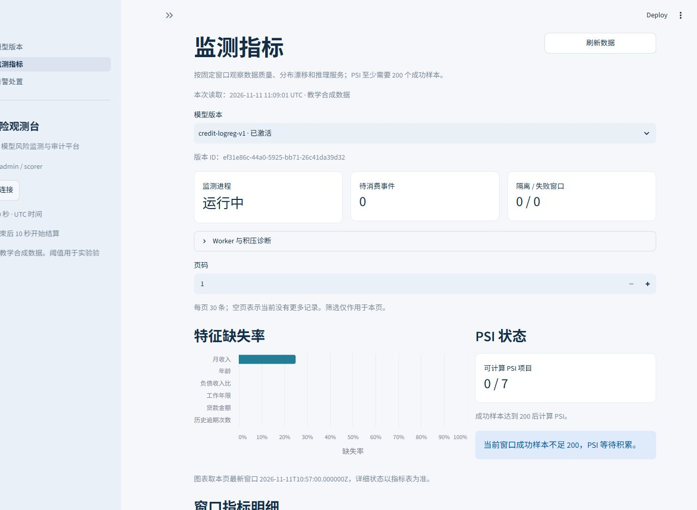
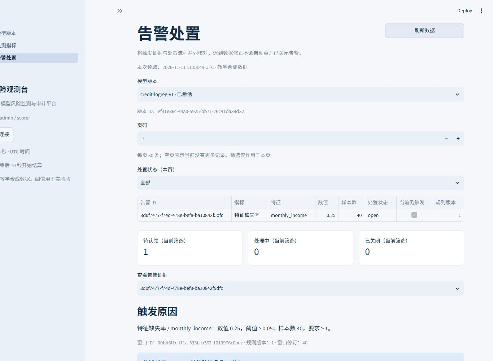

# 金融 AI 模型风险监测与审计平台

## 软件需求说明书初稿

文档版本 V0.2

编制日期 2026 年 11 月 11 日

编制方 项目组成员 A

适用阶段 A1 至 A5 已实现功能

## 修订记录

| 日期 | 版本 | 修改范围 | 修改描述 |
| --- | --- | --- | --- |
| 2026 年 11 月 11 日 | V0.1 | 全文 | 形成数据、模型、评分、监测、告警和页面功能的需求初稿 |
| 2026 年 11 月 11 日 | V0.2 | 双人合作与交接 | 补充成员职责、实际进度、接口交接和联调验收安排 |

## 1 介绍

### 1.1 项目的目标

本项目面向金融科技与人工智能课程实验，围绕模拟信贷模型建立从版本登记、受控激活、评分留痕到风险监测和告警处置的业务流程。系统通过保存模型、输入、解释、监测窗口及规则版本，使一次评分结果与其后续风险信号能够关联核查。

本阶段交付覆盖 A1 至 A5。读者包括课程教师、模型开发人员、平台开发人员和实验验证人员。文档用于核对已实现功能的输入输出、处理规则、界面表现和验收条件。

### 1.2 项目的开发背景

信贷模型投入服务后，输入缺失、数据分布变化和推理故障会影响评分使用。仅保存最终概率难以解释模型当时使用的输入、版本和阈值。实验将这些问题转化为可复现的数据与软件需求，使用合成信贷样本、固定版本的逻辑回归模型和可追溯的监测记录展示完整处理过程。

系统使用中位数填补、标准化和逻辑回归组成的固定 Pipeline。解释采用特征在 log-odds 空间中的贡献，按绝对值选出前三项，随评分保存解释快照。监测结果以缺失率、PSI、推理失败率和推理耗时 P95 表达。

### 1.3 项目的范围

当前范围包括合成数据生成与校验、两版模型训练和加载校验、模型版本查询与激活、评分与原子留痕、持久事件消费、窗口指标、规则版本、告警认领与关闭，以及模型版本、监测指标、告警处置三个页面。

当前身份入口为服务端配置的演示 Bearer 令牌，持久化使用可替换的 SQLite 适配器。评分审计、激活回执、规则变更和告警操作记录已保存。本文中的审计能力指这些已落地的记录与关联证据。

### 1.4 项目的用户特征

模型开发人员能够使用 Python 脚本生成数据、训练模型并检查版本包。管理员通过页面查看版本、激活模型，并查询监测进程状态和积压。获授权的评分调用方通过 HTTP API 提交合成特征并获取评分结果。具备管理权限的用户维护规则、认领告警和填写关闭说明。

当前演示管理员具有 admin 和 scorer 角色，演示评分用户具有 scorer 角色。后端同时核对角色与模型授权范围。scorer 可以读取授权模型的版本、指标、规则和告警，管理操作由后端进一步限制。risk_manager 的规则与告警权限已在服务端处理逻辑中支持。

## 2 假定与约束

### 2.1 数据约束

实验数据由固定随机种子产生，训练集 5000 条、测试集 1000 条、参考集 1000 条，以及正常、漂移、缺失评分流各 1000 条，总计 10000 条。缺失评分流中月收入缺失 100 条。数据清单记录文件摘要、行数和生成配置。

训练集用于拟合预处理和模型，测试集用于留出评估，参考集用于固定监测分箱。客户引用 customer_ref 和合成标签 synthetic_default_label 从特征列表中排除。线上监测以持久化评分事件及原始输入快照为数据来源。

### 2.2 模型约束

已交付版本为 credit-logreg-v1 和 credit-logreg-v2。两版使用相同特征顺序、预处理和 0.5 决策阈值，逻辑回归参数 C 分别为 1.0 和 0.5。版本目录中的模型、模式、参考分布、配置、环境和评估文件通过清单关联。

加载模型时先核对独立登记的受信任清单摘要、包内文件摘要和运行环境，再反序列化 Pipeline。模型包要求 CPython 3.12.14、Windows AMD64，以及包内列明的依赖版本。相同版本目录创建后保持固定。

### 2.3 时间与运行约束

评分按服务端受理时间进入 UTC 60 秒非重叠窗口，窗口采用左闭右开区间。窗口结束后保留 10 秒宽限，再由独立 Worker 结算。规则按窗口开始时间选择并冻结。迟到事件进入其原所属窗口，追加窗口修订并触发重算。

API、Worker 和页面分别运行。API 与 Worker 使用同一数据库和模型目录，页面通过配置的 API 地址交互。当前界面以手动刷新更新结果，每页展示 30 条记录，筛选与图表范围在页面中标明。

## 3 功能需求

### 3.1 合成数据准备

#### 3.1.1 功能描述

需求编号 FR01。系统应支持使用固定种子生成六组实验数据，并通过独立校验检查行数、字段、范围、缺失率、摘要和数据隔离关系。

#### 3.1.2 处理流程

执行数据生成脚本，分别输出训练、测试、参考和三类评分流。生成后写入 manifest，记录数据版本及摘要。执行校验脚本检查所有文件，并检查标签与客户引用没有进入模型特征。固定参数重复生成时，各文件内容应一致。

#### 3.1.3 其他规定

金额字段按人民币元记录为十进制字符串。评分流中的空字段在组装请求时转换为缺失值，原始输入和规范化输入分别保存。独立校验失败时应报告具体文件或字段，终止该次数据验收。

#### 3.1.4 参数说明

| 字段 | 含义 | 规范值与范围 | 单位 |
| --- | --- | --- | --- |
| age | 年龄 | 整数值，18 至 80 | 岁 |
| monthly_income | 月收入 | 十进制字符串，0 至 1000000，最多两位小数 | 元 |
| debt_income_ratio | 负债收入比 | 有限数值，0 至 3 | 比例 |
| past_due_count | 历史逾期次数 | 整数值，0 至 100 | 次 |
| loan_amount | 贷款金额 | 十进制字符串，0.01 至 10000000，最多两位小数 | 元 |
| employment_years | 工作年限 | 有限数值，0 至 60 | 年 |

六个特征均允许缺失，省略、null 和空字符串在当前规范化逻辑中归为缺失。布尔值、非有限数值、越界值、金额数值型输入和非约定字段应返回输入错误。customer_ref 为可选字符串，长度最多 128 个字符。

### 3.2 模型版本管理

#### 3.2.1 模型包登记与查询

需求编号 FR02。系统应加载受控脚本产生并已登记的模型包。API 启动时从受信任登记信息初始化版本元数据，查询接口仅返回调用者获授权的模型版本。

登记信息包括模型 ID、版本 ID、版本名称、清单摘要、验证状态和激活状态。模型目录包含 Pipeline、特征模式、训练配置、参考分布、解释配置、环境清单、评估和固定样例。包文件不完整、摘要不一致或环境不匹配时，校验应失败。

界面介绍见第 5.1 节。用户选择版本后可查看完整标识，核对版本名称、状态和清单摘要。

#### 3.2.2 模型激活

需求编号 FR03。管理员应能够在确认后激活受信任版本。请求输入为版本 UUID 和幂等键，后端检查管理员角色、模型授权和包有效性，再以同一事务更新激活指针、审计记录和激活回执。

成功激活返回 HTTP 200。相同身份在相同操作上使用同一幂等键和相同内容重试，应获取原回执。同键异内容返回 HTTP 409。激活失败时应保持持久化状态一致。新评分请求仅允许使用当前激活版本。

页面应禁用已激活版本的激活按钮。管理员须先勾选确认，再提交操作。收到成功提示后可刷新版本登记簿核对结果。

### 3.3 模拟评分与证据保存

#### 3.3.1 功能描述

需求编号 FR04。获授权的 scorer 应能够指定模型版本，提交六个合成特征并获取概率、阈值判断、解释及记录标识。接口应保存成功或终态推理失败的结果，支持幂等查询与重试。

#### 3.3.2 处理流程

第一步，记录请求受理时间并规范化输入，检查特征、客户引用、版本和授权。第二步，按身份、操作和幂等键查询已保存回执，核对规范请求摘要。第三步，对有效的新请求核对激活状态，加载固定模型并执行 Pipeline。第四步，计算解释并测量 predict_proba 推理耗时。第五步，在同一事务中写入输入快照、评分、初始审计和 outbox 完成事件。事务提交后返回结果。

#### 3.3.3 结果与异常

正常结果返回 HTTP 201，包含 prediction_id、模型版本、受理与完成时间、状态、risk_probability、阈值、决策、解释和推理时间。解释保留完整贡献及绝对贡献最大的三项。

参数不合法返回 422，未认证返回 401，权限不足返回 403，版本不存在返回 404，幂等冲突或非激活版本返回 409。已保存的终态推理失败返回 503，概率与决策等不可用字段保持空值。数据库不可写时返回存储不可用错误，调用方可用同一幂等键重试。

当前 INFERENCE_TIMEOUT_MS 默认 2000。该值在模型调用返回后检查，超时结果按失败保存。耗时度量仅覆盖约定的推理操作，关联的加载、HTTP 和事务时间由各自时间字段区分。

#### 3.3.4 参数说明

| 参数 | 类型 | 约束或用途 |
| --- | --- | --- |
| model_version_id | UUID 字符串 | 指定已激活且获授权的版本 |
| input | JSON 对象 | 六个特征及可选 customer_ref |
| Authorization | HTTP 请求头 | Bearer 令牌，服务端解析身份 |
| Idempotency-Key | HTTP 请求头 | 长度 1 至 128，允许字母、数字、点、下划线、冒号和连字符 |

### 3.4 评分事件消费与恢复

#### 3.4.1 功能描述

需求编号 FR05。监测 Worker 应独立消费已保存的 prediction.completed 事件，支持去重、崩溃恢复、退避、隔离和带原因的人工重试。

#### 3.4.2 处理流程

Worker 认领事件时取得 30 秒租约和随机租约令牌。消费前检查事件模式、事件内容、评分结果和原始快照的一致性，随后以短事务写入消费标记、窗口计数、窗口修订及完成状态。重复事件应只产生一份逻辑消费结果。

统计阶段在事务外计算指标，再通过窗口修订比较更新持久结果。发布时将指标、指标修订、告警、告警修订及已计算修订号一并提交。事件已消费而统计未完成时，后续轮询应继续处理脏窗口。

#### 3.4.3 其他规定

单轮默认最多消费 100 个事件、计算 20 个窗口，默认轮询间隔为 5 秒。失败最多尝试 5 次，采用 1、2、4、8 秒退避，超限事件进入 dead_letter，失败窗口进入 calculation_failed。人工重试命令只处理已隔离任务，要求填写原因并保存先前错误和尝试次数。

Worker 状态查询返回心跳、队列计数、待计算与失败窗口及隔离任务信息。最近完成轮询的心跳在 15 秒内显示 fresh，过期显示 stale，尚无心跳时显示 never_started。

### 3.5 窗口指标监测

#### 3.5.1 功能描述

需求编号 FR06。系统应按模型版本和固定窗口计算缺失率、特征 PSI、预测 PSI、推理失败率与推理耗时 P95，并保存计算状态、样本数、单位、参考摘要和修订信息。

#### 3.5.2 参数与统计口径

| 指标 | 计算口径 | 样本与状态 | 单位 |
| --- | --- | --- | --- |
| 特征缺失率 | 成功评分中原始特征缺失条数除以成功评分数 | 六个特征分别统计 | 比例 |
| 特征 PSI | 评分特征分布与固定参考分布逐箱比较 | 成功样本至少 200 条 | 指数 |
| 预测 PSI | 成功评分概率分布与固定参考概率分布比较 | 成功样本至少 200 条 | 指数 |
| 推理失败率 | 已尝试推理的失败数除以尝试总数 | 加载模型前失败按未尝试处理 | 比例 |
| 推理耗时 P95 | 成功评分的 predict_proba 耗时第 95 百分位 | 使用线性分位数方法 | 毫秒 |

每个窗口保存 15 项指标，分别为六项缺失率、六项特征 PSI、一项预测 PSI、一项失败率和一项 P95。PSI 使用模型包固定分箱、缺失箱和 0.000001 平滑量，平滑后重新归一化。处在分箱切点上的值划入右侧箱。

#### 3.5.3 状态与修订

有效结果标记为 ready，样本不足标记为 insufficient_samples，分母无数据时记录 no_data。不可计算的值保持空值。接口应同时提供窗口最新修订和指标已计算修订。

存在未消费的本窗口事件，或指标修订落后于最新窗口修订时，stale 应为真。页面应提示待更新，并从有效趋势点中排除这些记录。迟到样本触发同一窗口重算，保留先前修订，并沿用原窗口冻结的规则。

#### 3.5.4 界面介绍

监测页上方显示进程状态、待消费事件和隔离或失败窗口。中部以条形图展示本页最新窗口的各特征缺失率，并展示 PSI 项目的可计算状态。下方显示窗口指标表、单序列趋势和规则版本。用户可展开统计详情检查计算版本和参考清单摘要。

### 3.6 监测规则配置

#### 3.6.1 功能描述

需求编号 FR07。admin 或 risk_manager 应能够为获授权模型创建追加的规则版本，查询接口应保留规则历史。默认规则与版本模型初始化后可直接用于监测。

#### 3.6.2 处理流程

用户选择指标与适用特征，输入阈值、最少样本数和未来 UTC 整分钟生效时间。后端检查角色、模型范围和字段约束，根据模型版本、指标和特征生成递增规则版本，并以同一事务保存规则、审计和幂等回执。

#### 3.6.3 参数说明

缺失率与特征 PSI 必须指定六个特征之一，整体指标使用空特征。比例阈值范围为 0 至 1，其他阈值为有限非负数。最少样本数范围为 1 至 100000，PSI 至少为 200。生效时间必须带时区并落在未来 UTC 整分钟。

默认教学阈值分别为缺失率大于 0.05、PSI 大于 0.2、失败率大于 0.01、推理耗时 P95 大于 500 毫秒。所有告警比较均为严格大于，并同时满足样本下限。

### 3.7 告警生成与处置

#### 3.7.1 功能描述

需求编号 FR08。系统应根据窗口指标和冻结规则生成告警，保存触发数值、样本数、规则快照和窗口修订。管理用户应能够认领告警，并在填写说明后关闭告警。

#### 3.7.2 处理流程

Worker 判断指标状态为 ready、样本数达到规则要求且数值严格大于阈值时创建 open 告警。告警按窗口和规则唯一。管理用户执行认领后，状态变为 acknowledged，并保存责任人与动作记录。管理员或该告警认领人提交非空说明后，状态变为 closed。

#### 3.7.3 其他规定

人工动作、状态更新、审计和幂等回执保持事务一致。重复提交同一命令返回原回执，非法状态流转返回 409，缺少关闭说明返回 422。告警详情应展示最多 100 条修订和 100 条动作记录。

迟到数据可能改变 condition_active，人工处置状态继续保留。已关闭告警的触发条件变化通过修订历史表达，后续窗口按其自身规则生成新的告警。

#### 3.7.4 界面介绍

告警页面提供版本、页码和状态筛选，展示当前筛选结果的待认领、处理中、已关闭数量。选中告警后，页面列出指标、特征、实际数值、阈值、样本数、样本要求、规则版本、窗口标识和修订。证据区可展开冻结规则及完整记录，管理用户通过表单认领或关闭。

### 3.8 访问与会话管理

需求编号 FR09。用户通过密码型输入框提交服务端已配置的演示令牌。页面调用身份接口验证后进入模型、监测和告警页面，每次重绘重新获取服务端身份。退出时清空当前会话。

令牌在 Streamlit 当前服务端会话中使用。API 地址由服务端环境变量提供。客户端设置有限网络超时，禁用自动跟随重定向，POST 使用显式幂等键。网络结果未知时保留当前命令键，收到成功回执后结束该命令，后续主动操作生成新键。

## 4 性能需求

### 4.1 处理与查询边界

当前查询接口默认每页 20 条，单页最大 100 条，页面使用每页 30 条。版本切换、指标筛选和分页均通过既有 API 或已读取的当前页数据完成。图表按页面标注的数据范围显示。

评分请求中执行模型推理和证据事务，监测在独立进程消费完成事件。数据库可用时，Worker 暂停期间产生的评分事件保持持久化，Worker 恢复后继续消费。该分工由进程恢复和事务故障注入测试覆盖。

### 4.2 时间参数

已实现的时间控制包括 60 秒监测窗口、10 秒结算宽限、默认 5 秒 Worker 轮询、30 秒事件租约、15 秒心跳新鲜度，以及默认 2000 毫秒的推理返回后超时检查。页面 HTTP 客户端的总超时为 10 秒，连接超时为 3 秒。

这些参数作为当前行为与配置约束记录。现阶段验收以功能正确性、去重、恢复和状态一致性为依据。独立演示采用显式推进 120 秒的测试结算时钟，原始评分时间保持原值。

## 5 用户界面和接口需求

### 5.1 模型版本界面

界面展示已登记版本数、所选版本、服务状态和版本登记簿。版本名称、激活状态、验证状态及完整标识应可查看。页面以管理员角色控制激活表单的呈现，并由 API 完成最终授权。激活时要求勾选确认，成功提示与刷新入口应清晰可见。

### 5.2 监测指标界面

界面展示监测进程、积压、缺失率条形图、PSI 可计算状态、窗口指标明细、趋势和规则表。原始 API 比例在表格中使用 0 至 1 表示，缺失率图使用百分比刻度。空指标保持空值，样本不足和待更新信息应显示。规则表优先呈现指标、特征、版本、阈值、样本下限和生效时间。

### 5.3 告警处置界面

界面将触发证据与人工处置状态共同展示。状态筛选和数量卡片标注为当前筛选，告警详情提供完整规则快照和操作历史。关闭表单要求填写说明。页面以“当前触发条件”和“处置状态”表达两个独立字段。

### 5.4 HTTP 接口

| 方法 | 路径 | 主要能力 |
| --- | --- | --- |
| GET | /health | 数据库可达性检查 |
| GET | /api/v1/me | 当前身份、角色和模型授权 |
| GET | /api/v1/model-versions | 授权版本列表 |
| POST | /api/v1/model-versions/{id}/activate | 版本验证与激活 |
| POST | /api/v1/predictions | 评分与原子留痕 |
| GET | /api/v1/metrics | 窗口指标分页查询 |
| GET 或 POST | /api/v1/monitor-rules | 查询或创建规则版本 |
| GET | /api/v1/alerts | 告警分页查询 |
| GET | /api/v1/alerts/{id} | 告警证据、修订和动作 |
| POST | /api/v1/alerts/{id}/acknowledge | 认领告警 |
| POST | /api/v1/alerts/{id}/close | 关闭告警 |
| GET | /api/v1/monitor/status | 管理员查询进程与积压 |

除健康检查外，业务接口要求 Bearer 身份。POST 命令要求幂等键，服务端同时检查模型授权及操作角色。接口详情由 FastAPI 的 /docs 和 /openapi.json 提供。

## 6 软硬件环境需求

### 6.1 软件环境

模型运行环境为 CPython 3.12.14、Windows AMD64。主要锁定依赖包括 scikit-learn 1.9.1、NumPy 2.5.4、SciPy 1.18.1、joblib 1.6.0、FastAPI 0.162.0、SQLAlchemy 2.0.57、httpx 0.28.1、Streamlit 1.66.1、pandas 3.1.1 和 Altair 6.3.0。完整清单见 requirements-a5.lock.txt，模型包内另附环境约束。

API 通过 Uvicorn 启动，Worker 通过独立 Python 进程启动，页面通过根目录 streamlit_app.py 启动。浏览器需支持现代 JavaScript、表格和 Vega-Lite 图形渲染。

### 6.2 文件与运行配置

artifacts 目录保存固定版本模型包，data/synthetic/v1 保存合成样本，data/runtime 保存本地运行数据库与演示配置，evidence 保存验证记录。配置通过 DATABASE_URL、ARTIFACT_ROOT、APP_ADMIN_TOKEN、APP_SCORER_TOKEN、INFERENCE_TIMEOUT_MS 和 API_BASE_URL 环境变量提供。

管理员与 scorer 令牌各至少 32 字符且互不相同。运行目录可写，模型包目录可读，API 与 Worker 对同一数据库访问。复验脚本可创建隔离运行目录，分别启动本地 API、Worker 和页面。

## 7 质量需求

### 7.1 正确性

特征顺序、预处理、阈值、参考分箱和解释配置应由版本模型包固定。指标应按模型版本与 UTC 窗口隔离。缺失率基于原始输入，失败率基于尝试推理计数，PSI 应检查成功样本下限。相同幂等命令应关联同一逻辑结果。

### 7.2 健壮性

非法字段、越界值、无效 UUID 和非法幂等键应返回可识别错误。模型包缺失、摘要改变、环境不符、推理故障和存储错误应进入明确的失败路径。页面应展示认证、权限、冲突、参数及服务错误提示。

### 7.3 可靠性

评分证据和完成事件应同事务保存。租约令牌应阻止旧消费者覆盖已被重新认领的工作，消费检查点和窗口修订应支持中断后继续计算。失败重试应有限次，隔离任务应可定位，人工恢复应附原因和历史错误。

### 7.4 易用性与清晰性

页面应使用中文业务标签，提供版本选择、刷新、分页、状态筛选和证据展开入口。监测页应以图表与明细同时展示数值、样本和状态。告警页应显示触发比较、规则版本和处置说明。

### 7.5 访问安全

所有业务请求应由后端校验身份与模型范围。管理员管理版本，admin 或 risk_manager 管理规则与告警，scorer 在授权模型内调用评分并读取允许的数据。令牌字段使用密码型控件，本地凭据和运行数据库放入忽略的运行目录。

### 7.6 可维护性与兼容性

身份、预测存储和监测存储通过适配器边界关联服务。模型包以清单和依赖锁支持环境复现。A4 在既有 A3 outbox 上增加租约令牌列，通过增量初始化兼容旧库。指标、规则与告警修订保存版本信息，支持沿历史记录核对。

## 8 附录 A 已实现需求与验证对应

| 需求编号 | 已实现功能 | 主要实现位置 | 验证依据 |
| --- | --- | --- | --- |
| FR01 | 合成数据生成与校验 | scripts/generate_data.py 与 validate_data.py | test_data_preparation.py |
| FR02 | 固定模型包与版本查询 | app/modules/models 与 app/main.py | test_model_package.py |
| FR03 | 管理员激活与幂等回执 | app/modules/scoring/service.py | test_scoring_api.py |
| FR04 | 评分与事务留痕 | app/modules/scoring 与 app/storage | test_scoring_api.py |
| FR05 | 事件租约、去重与恢复 | app/worker.py 与 monitoring/store.py | test_monitoring_worker.py |
| FR06 | 窗口指标与迟到修订 | app/modules/monitoring | test_monitoring_worker.py |
| FR07 | 规则版本与生效边界 | app/modules/alerts/commands.py | test_monitoring_worker.py |
| FR08 | 告警、认领和关闭 | app/modules/alerts 与 ui/pages/alerts.py | Worker API 测试与页面测试 |
| FR09 | 令牌会话与角色展示 | app/demo_auth.py 与 ui/app.py | test_ui.py |

既有 A1 至 A5 验证记录累计通过 108 项测试，包含 18 项页面、客户端和身份测试。记录文件为 evidence/A5-validation-summary.json，原始验收日期为 2026 年 11 月 5 日。本次界面修订后的复验结果独立保存在 evidence/界面重生成验收-20261111.json。

模型 v1 在 1000 条合成测试样本上的 ROC AUC 为 0.797800，准确率为 0.786，召回率为 0.366795。这些指标来自固定留出评估。窗口监测按照缺失率、分布漂移及运行指标展示当前评分流状态。

## 9 附录 B 当前界面

### 9.1 模型版本

### 9.2 监测指标

### 9.3 告警处置

## 10 双人合作与交接

### 10.1 成员职责与当前进度

项目按模型监测与审计平台两个方向开展协作。成员 A 负责合成数据、固定模型、评分解释、监测算法、规则与告警、三个页面，主笔业务架构、逻辑架构和一级数据流图。A1 至 A5 已形成可运行交付与 108 项自动化验证记录。

成员 B 接手当前存储与配置基线，负责正式账号与角色授权、审计详情和导出、历史复现任务、审计与复现页面，主笔数据、技术和部署架构，并汇总报告。B 的正式实现、双方人工交叉检查和最终集成验收待实际执行后登记。

当前 SQLite 参考存储、演示认证和配置由 A 为原型交付。B 后续从既有模块补充正式平台能力，按实际适配、迁移、审查和联调提交登记贡献。姓名、学号、工时与人工检查意见由实际成员填写。

### 10.2 交付材料与接口交接

A 交给 B 的材料包括六组合成数据、两个固定模型包、特征与解释模式、标准评分样例、故障分类、事务和事件契约、窗口与规则口径，以及页面截图与验证报告。B 接手时核对运行环境、样例概率、原始缺失信息和关联编号。

正式身份适配器返回服务端 Principal，包含 principal_id、roles 和 model_ids。当前身份查询接口继续向页面提供这些字段。预测存储和监测存储共同关联评分、快照、审计、outbox、消费标记、窗口修订和回执，替换适配器时核对旧库兼容。

B 向 A 交付证据查询、审计导出和复现接口后，A 核对历史版本、输入、阈值、解释和概率的一致性。复现使用原评分固定的 Pipeline，并记录新计算和原记录的差异。

### 10.3 实施顺序与文件协作

现有公开仓库为 Cherable/financial-ai-model-risk-platform。A 在 A/model-monitoring 工作，B 在 B/audit-platform 工作，main 用于双方检查后的集成。B 接手时在自己的分支合并 A 已交付基线，先复验既有功能，再按 B1 数据与迁移、B2 身份权限、B3 审计导出、B4 复现任务、B5 页面部署的顺序提交。

共享契约、应用工厂、SQLAlchemy 元数据、配置、依赖锁和需求说明书随任务主责修改，并在交叉检查中核对调用方与持久化行为。模型、参考分箱与统计问题由 A 主修，正式身份、审计和复现组织问题由 B 主修。

### 10.4 共同验收与记录

双方联调包括正常评分、幂等与故障、Worker 暂停恢复、原始缺失和 PSI 样本下限、规则生效与迟到修订、告警认领关闭、正式权限，以及历史审计复现八类案例。A 核对模型和统计结果，B 核对授权、事务和证据关系，检查者记录实际问题与复核结论。

当前 M3 评分留痕和 M4 监测告警功能已实现，双人联调待执行。M5 正式权限、审计导出与历史复现属于 B 后续工作。M6 已有 A 的架构、需求初稿和自动化证据，后续汇总 B 的三类架构与最终报告。

每条记录包含任务编号、实际执行人、提交 SHA、验证命令、结果路径、检查者和待解决问题。PR 说明列出具体变化及验证结果，另一成员记录检查意见后集成，并对集成提交重新验收。详细执行步骤见项目文档《双人协作与集成验收》。
